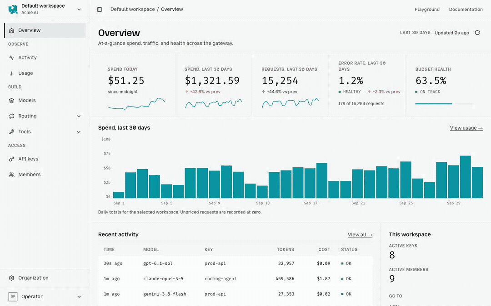

<p align="center">
  
</p>

<div align="center">

**An AI gateway you own and run.**

Route one endpoint to 40+ providers, issue virtual keys, enforce budgets, and
track usage.

[](https://github.com/mozilla-ai/otari/actions/workflows/otari-tests.yml)
[](https://github.com/mozilla-ai/otari/actions/workflows/otari-lint.yml)
[](https://github.com/mozilla-ai/otari/actions/workflows/otari-typecheck.yml)
[](https://github.com/mozilla-ai/otari/actions/workflows/otari-docker.yml)


[Docs](docs/index.md) · [otari.ai](https://otari.ai) ·
[Launch blog](https://blog.mozilla.ai/otari-own-your-ai-stack/) ·
[Discord](https://discord.gg/ZfZPfTdtSe)

English · [简体中文](README.zh-CN.md)

</div>

> [!NOTE]
> **Developers Wilding, our AI hackathon at MozFest, runs until November 11.**
> Build something with Otari and open-weight models for a chance at the $1,000
> prize (plus runner-up prizes) and dedicated time with our AI engineers.
> [Details and submissions](https://otari.ai/devs-wilding).

<p align="center">
  
</p>

Otari sits between your applications and model providers. It authenticates
requests, resolves provider credentials, enforces budgets before dispatch, and
records usage afterwards. Provider calls go through
[any-llm](https://github.com/mozilla-ai/any-llm).

Run Otari with your own database and provider keys.

## Why Otari

- One OpenAI and Anthropic-compatible endpoint for many providers
- Provider credentials stay behind the gateway
- Revocable API keys with user, workspace, and model scope
- Budget checks before spend and usage records after settlement
- Local routing policies for failover, conditional selection, traffic splitting, and spill-over past a rate limit
- Optional code execution, web search, MCP, inference guardrails, and file understanding

## Quickstart

Run Otari with Docker. It needs no configuration:

```bash
docker run -v otari:/data -p 127.0.0.1:8000:8000 mzdotai/otari:latest
```

On its first start, Otari prints a setup link once, and little else:

```text
Otari 1.0.0 is running at http://localhost:8000

Open this link to choose your password and finish setup:

http://localhost:8000/#/setup?key=otari-mk-...

It is shown only once and carries your master key, so treat it like one.
```

Open it and choose the email and password you will sign in with. Then add a
provider on the dashboard's **Hosted providers** page and enable default
pricing there. The key in the link is the gateway's master key, so keep the
link private.

Create an API key in the dashboard, from the setup guide on the **Overview** or
on the **API keys** page, and send a request with it:

```bash
curl http://localhost:8000/api/v1/chat/completions \
  -H "Authorization: Bearer tk-..." \
  -H "Content-Type: application/json" \
  -d '{
    "model": "openai:gpt-4o-mini",
    "messages": [{"role": "user", "content": "Say hello."}]
  }'
```

OpenAI clients work by setting `base_url` to
`http://localhost:8000/api/v1`.

The `otari` volume holds the SQLite database and, beside it, the generated key
that encrypts stored provider credentials, so a new container started with the
same `-v otari:/data` keeps its data. Without `-v`, Docker gives each container
a fresh anonymous volume. Use the Compose setup below to run on PostgreSQL.

The command a developer runs next to a coding agent (`otari hook`,
`otari import claude-code`) installs on its own, without the server:

```bash
brew install mozilla-ai/tap/otari
```

See [Agent Guardrails](cli/docs/agent-guardrails.md) and
[Use with Claude Code](docs/use-with-claude-code.md).

## Run the full stack

```bash
git clone https://github.com/mozilla-ai/otari
cd otari
cp config.example.yml config.yml
# Set a master key, provider credentials, and pricing in config.yml.
# Provider copies of attached files are off until they have a pepper of their own. Compose reads .env.
grep -qs OTARI_PROVIDER_ACCOUNT_PEPPER .env || echo "OTARI_PROVIDER_ACCOUNT_PEPPER=$(openssl rand -base64 32)" >> .env
docker compose pull
docker compose up -d
```

Compose runs Otari with PostgreSQL. Optional profiles add the code sandbox,
web search, and guardrail services:

```bash
docker compose --profile code-exec --profile web-search --profile guardrails up -d
```

The dashboard is served at `http://localhost:8000/`. To store provider keys
through the dashboard on PostgreSQL, set `OTARI_SECRET_KEY` to a Fernet key
generated by `otari gen-secret-key`.

A one-click deployment template is available for
[Railway](deploy/railway/README.md).

## API and dashboard

The core completion routes are:

- `POST /api/v1/chat/completions`
- `POST /api/v1/messages`
- `POST /api/v1/responses`

Otari also serves the broader OpenAI-compatible and management APIs. The
running server publishes Swagger UI at `/api/v1/docs` and OpenAPI at
`/api/v1/openapi.json`. See [API reference](docs/api-reference.md).

The dashboard manages providers, models, routing, tools, keys, members, budgets,
settings, activity, and usage. Its navigation adapts to the signed-in person's
authority. See [Run the dashboard](docs/run-the-dashboard.md).

## Development

```bash
git clone https://github.com/mozilla-ai/otari
cd otari
uv sync --dev
cp config.example.yml config.yml
uv run otari serve --config config.yml
```

For local development without PostgreSQL, change `database_url` to
`sqlite+aiosqlite:///./otari.db`.

Common checks:

```bash
make test
make lint
make typecheck
```

See [CONTRIBUTING.md](CONTRIBUTING.md) before opening a pull request.

## Documentation

- [Quickstart](docs/self-hosted-quickstart.md)
- [Deployment](docs/deployment.md)
- [Configuration](docs/configuration.md)
- [Models](docs/models.md)
- [Routing](docs/routing.md)
- [Access control](docs/access-control.md)
- [Built-in tools](docs/tools.md)
- [Agent Guardrails](cli/docs/agent-guardrails.md)
- [SDK and agent integrations](docs/index.md#integrations)
- [Architecture](ARCHITECTURE.md)

## License

Apache 2.0. See [LICENSE](LICENSE).
