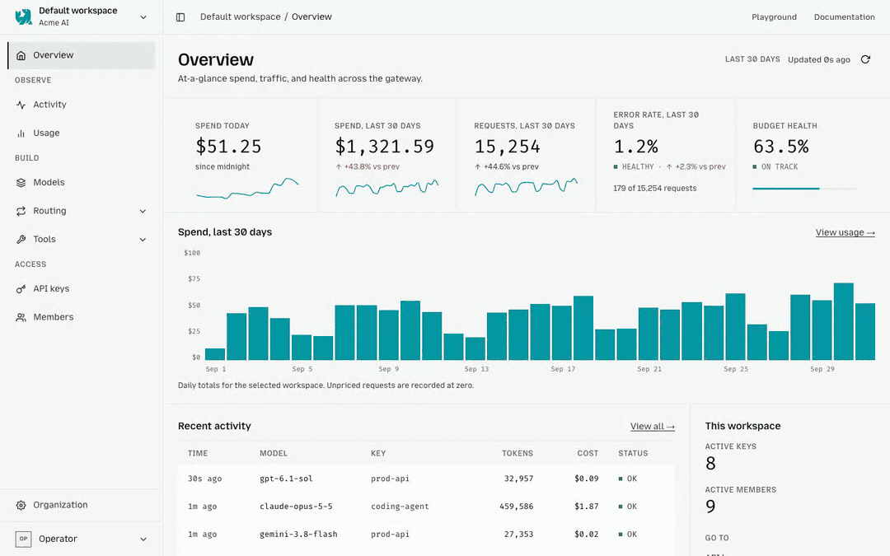

<!-- Translated from README.md at commit 49ab63604. `git diff 49ab63604 -- README.md` shows what this translation has not caught up with. -->

<p align="center">
  
</p>

<div align="center">

**一个由你自己拥有和运行的 OpenAI 兼容 LLM 网关。**

用一个端点路由到 40 多家模型提供商，签发虚拟密钥，执行预算限制，并跟踪用量。

[](https://github.com/mozilla-ai/otari/actions/workflows/otari-tests.yml)
[](https://github.com/mozilla-ai/otari/actions/workflows/otari-lint.yml)
[](https://github.com/mozilla-ai/otari/actions/workflows/otari-typecheck.yml)
[](https://github.com/mozilla-ai/otari/actions/workflows/otari-docker.yml)


[文档](docs/index.md) · [otari.ai](https://otari.ai) ·
[发布博客](https://blog.mozilla.ai/otari-own-your-ai-stack/) ·
[Discord](https://discord.gg/ZfZPfTdtSe)

[English](README.md) · 简体中文

</div>

> 本页是 README 的简体中文译本。完整文档目前仅提供英文版，下文中的文档链接均指向英文页面。

<p align="center">
  
</p>

Otari 位于你的应用和模型提供商之间。它对请求进行身份验证，解析模型提供商凭据，在发出请求前执行预算检查，并在请求完成后记录用量。对模型提供商的调用通过
[any-llm](https://github.com/mozilla-ai/any-llm) 完成。

你可以用自己的数据库和模型提供商密钥以独立模式运行 Otari，也可以将一个数据平面连接到
[otari.ai](https://otari.ai)。

## 为什么选择 Otari

- 一个同时兼容 OpenAI 和 Anthropic 的端点，接入众多模型提供商
- 模型提供商凭据始终保留在网关之后
- 可撤销的 API 密钥，可按用户、工作区和模型限定范围
- 在产生支出前检查预算，结算后记录用量
- 本地路由策略，支持故障转移、权重分配和基于学习的选择
- 可选的代码执行、网页搜索、MCP、推理护栏（guardrails）和文件理解

## 快速开始

使用 Docker 运行一个临时的独立模式网关：

```bash
docker run --rm -p 8000:8000 \
  -e OTARI_MASTER_KEY=SET_A_MASTER_KEY \
  -e OPENAI_API_KEY=YOUR_OPENAI_KEY \
  -e OTARI_CONFIG_YAML='
default_pricing: true
providers:
  openai:
    api_key: ${OPENAI_API_KEY}
' \
  mzdotai/otari:latest \
  otari serve
```

首次遇到空数据库时，Otari 会创建一个 API 密钥并只打印一次：

```text
No API keys found. Created bootstrap key for first run. Save this key now:
tk-...
```

使用该密钥发送请求：

```bash
curl http://localhost:8000/api/v1/chat/completions \
  -H "Authorization: Bearer tk-..." \
  -H "Content-Type: application/json" \
  -d '{
    "model": "openai:gpt-4o-mini",
    "messages": [{"role": "user", "content": "Say hello."}]
  }'
```

OpenAI 客户端只需将 `base_url` 设置为
`http://localhost:8000/api/v1` 即可使用。

该容器在内部使用 SQLite，容器停止后数据即被删除。如需持久化数据，请使用下文的 Compose 部署方式。

开发者在编程智能体旁边运行的命令（`otari hook`、`otari import claude-code`）可以单独安装，无需服务端：

```bash
brew install mozilla-ai/tap/otari
```

参见 [Agent Guardrails](docs/agent-guardrails.md) 和
[在 Claude Code 中使用](docs/use-with-claude-code.md)。

## 运行完整服务栈

```bash
git clone https://github.com/mozilla-ai/otari
cd otari
cp config.example.yml config.yml
# Set a master key, provider credentials, and pricing in config.yml.
# Provider copies of attached files need a pepper of their own. Compose reads .env.
grep -qs OTARI_PROVIDER_ACCOUNT_PEPPER .env || echo "OTARI_PROVIDER_ACCOUNT_PEPPER=$(openssl rand -base64 32)" >> .env
docker compose pull
docker compose up -d
```

Compose 会搭配 PostgreSQL 运行 Otari。可选的 profile 会额外启动代码沙箱、网页搜索和护栏服务：

```bash
docker compose --profile code-exec --profile web-search --profile guardrails up -d
```

控制台地址为 `http://localhost:8000/`。如需通过控制台保存模型提供商密钥，请将 `OTARI_SECRET_KEY` 设置为由
`otari gen-secret-key` 生成的 Fernet 密钥。

[Railway](deploy/railway/README.md) 提供一键部署模板。

## 运行模式

| 模式 | 用途 |
| --- | --- |
| 独立模式（Standalone） | 单个进程使用本地存储，同时提供管理和推理服务。 |
| 托管模式（Hosted） | 多租户控制平面；推理在已连接的网关上运行。 |
| 混合模式（Hybrid） | 数据平面网关从 otari.ai 解析凭据，并向其上报用量。 |

未设置 `OTARI_MODE` 时，设置了 `OTARI_AI_TOKEN` 即选择混合模式；否则 Otari 默认使用独立模式。模式描述的是一个进程提供什么服务，而不是由谁来运行它，因此“托管模式”并不是“自托管”的反义词。参见
[运行模式](docs/modes.md#mode-and-who-runs-it)。

## API 与控制台

核心的补全路由有：

- `POST /api/v1/chat/completions`
- `POST /api/v1/messages`
- `POST /api/v1/responses`

独立模式还提供更完整的 OpenAI 兼容 API 和管理 API。运行中的服务在 `/api/v1/docs` 发布 Swagger UI，在
`/api/v1/openapi.json` 发布 OpenAPI 规范。参见 [API 参考](docs/api-reference.md)。

控制台用于管理模型提供商、模型、路由、工具、密钥、成员、预算、设置、活动和用量。其导航会根据部署模式和登录者的权限自动调整。参见 [管理控制台](docs/dashboard.md)。

## 开发

```bash
git clone https://github.com/mozilla-ai/otari
cd otari
uv sync --dev
cp config.example.yml config.yml
uv run otari serve --config config.yml
```

如需在没有 PostgreSQL 的情况下进行本地开发，请将 `database_url` 改为
`sqlite+aiosqlite:///./otari.db`。

常用检查：

```bash
make test
make lint
make typecheck
```

提交拉取请求前，请先阅读 [CONTRIBUTING.md](CONTRIBUTING.md)。

## 文档

- [快速开始](docs/quickstart.md)
- [部署](docs/deployment.md)
- [配置](docs/configuration.md)
- [模型](docs/models.md)
- [路由](docs/routing.md)
- [访问控制](docs/access-control.md)
- [内置工具](docs/tools.md)
- [Agent Guardrails](docs/agent-guardrails.md)
- [SDK 与智能体集成](docs/index.md#for-integrators)
- [架构](ARCHITECTURE.md)

## 许可证

Apache 2.0。参见 [LICENSE](LICENSE)。
