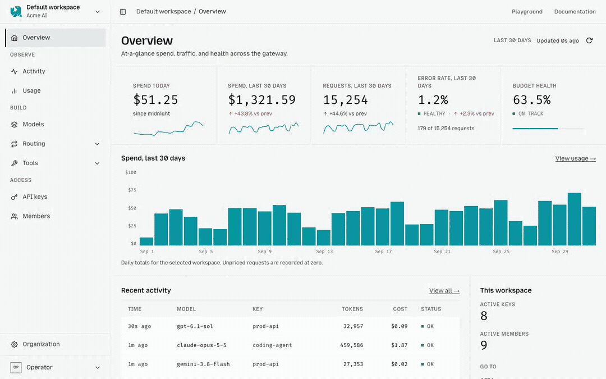

<!-- Translated from README.md at commit 4fe759f211. `git diff 4fe759f211 -- README.md` shows what this translation has not caught up with. -->

<p align="center">
  
</p>

<div align="center">

**一个由你自己拥有并运行的 AI 网关。**

通过一个端点接入 40 多家提供商，签发虚拟密钥，强制执行预算，并跟踪用量。

[](https://github.com/mozilla-ai/otari/actions/workflows/otari-tests.yml)
[](https://github.com/mozilla-ai/otari/actions/workflows/otari-lint.yml)
[](https://github.com/mozilla-ai/otari/actions/workflows/otari-typecheck.yml)
[](https://github.com/mozilla-ai/otari/actions/workflows/otari-docker.yml)


[文档](docs/index.md) · [otari.ai](https://otari.ai) ·
[发布博客](https://blog.mozilla.ai/otari-own-your-ai-stack/) ·
[Discord](https://discord.gg/ZfZPfTdtSe)

[English](README.md) · 简体中文

</div>

> [!NOTE]
> **我们的 AI 黑客松 Developers Wilding（在 MozFest 举办）将持续到 11 月 11 日。**
> 用 Otari 和开放权重模型构建项目，即有机会赢得 1000 美元奖金（另设亚军奖），
> 并获得与我们 AI 工程师专门交流的时间。
> [详情与提交](https://otari.ai/devs-wilding)。

> 本页是 README 的简体中文译本。完整文档目前仅提供英文版，下文中的文档链接均指向英文页面。

<p align="center">
  
</p>

Otari 位于你的应用和模型提供商之间。它为请求做身份验证，确定该用哪份提供商凭据，在发出请求前执行预算检查，并在请求结束后记录用量。对提供商的调用通过
[any-llm](https://github.com/mozilla-ai/any-llm) 完成。

你可以用自己的数据库和提供商密钥运行 Otari。

## 为什么选择 Otari

- 一个同时兼容 OpenAI 和 Anthropic 的端点，接入众多提供商
- 提供商凭据始终留在网关之后
- 可撤销的 API 密钥，可按用户、工作区和模型限定范围
- 在产生支出前检查预算，结算后记录用量
- 本地路由策略，支持故障转移、条件选择、流量拆分，以及触达速率限制后的溢出负载
- 可选的代码执行、网页搜索、MCP、推理护栏（inference guardrails）和文件理解

## 快速开始

使用 Docker 运行 Otari，无需任何配置：

```bash
docker run -v otari:/data -p 127.0.0.1:8000:8000 mzdotai/otari:latest
```

首次启动时，Otari 会打印一次设置链接：

```text
Otari 1.0.0 is running at http://localhost:8000

Open this link to choose your password and finish setup:

http://localhost:8000/#/setup?key=otari-mk-...

It is shown only once and carries your master key, so treat it like one.
```

打开该链接，选择用于登录的邮箱和密码。然后在控制台的 **Hosted providers** 页面添加一个提供商，并在该页面启用默认定价。链接中的密钥就是网关的主密钥，请妥善保管该链接。

在控制台中创建一个 API 密钥（通过 **Overview** 上的设置向导，或在 **API keys** 页面），然后用它发送请求：

```bash
curl http://localhost:8000/api/v1/chat/completions \
  -H "Authorization: Bearer tk-..." \
  -H "Content-Type: application/json" \
  -d '{
    "model": "openai:gpt-4o-mini",
    "messages": [{"role": "user", "content": "Say hello."}]
  }'
```

OpenAI 客户端只需将 `base_url` 设置为
`http://localhost:8000/api/v1` 即可使用。

`otari` 卷保存 SQLite 数据库，以及旁边那个用于加密已存储提供商凭据的自动生成密钥，因此使用同一个 `-v otari:/data` 启动的新容器会保留数据。不带 `-v` 时，Docker 会为每个容器创建一个新的匿名卷。如需使用 PostgreSQL，请使用下文的 Compose 部署方式。

开发者配合编程智能体使用的命令（`otari hook`、`otari import claude-code`）可以单独安装，无需服务端：

```bash
brew install mozilla-ai/tap/otari
```

参见 [Agent Guardrails](cli/docs/agent-guardrails.md) 和
[在 Claude Code 中使用](docs/claude-code.md)。

## 运行完整服务栈

```bash
git clone https://github.com/mozilla-ai/otari
cd otari
cp config.example.yml config.yml
# Set a master key, provider credentials, and pricing in config.yml.
# Provider copies of attached files are off until they have a pepper of their own. Compose reads .env.
grep -qs OTARI_PROVIDER_ACCOUNT_PEPPER .env || echo "OTARI_PROVIDER_ACCOUNT_PEPPER=$(openssl rand -base64 32)" >> .env
docker compose pull
docker compose up -d
```

Compose 会搭配 PostgreSQL 运行 Otari。可选的 profile 会额外启动代码沙箱和网页搜索服务：

```bash
docker compose --profile code-exec --profile web-search up -d
```

控制台地址为 `http://localhost:8000/`。如需在 PostgreSQL 上通过控制台保存提供商密钥，请将 `OTARI_SECRET_KEY` 设置为由
`otari gen-secret-key` 生成的 Fernet 密钥。

[Railway](deploy/railway/README.md) 提供一键部署模板。

## API 与控制台

核心的补全路由有：

- `POST /api/v1/chat/completions`
- `POST /api/v1/messages`
- `POST /api/v1/responses`

Otari 还提供更完整的 OpenAI 兼容 API 和管理 API。运行中的服务在 `/api/v1/docs` 发布 Swagger UI，在
`/api/v1/openapi.json` 发布 OpenAPI 规范。参见 [API 参考](docs/api-reference.md)。

控制台用于管理提供商、模型、路由、工具、密钥、成员、预算、设置、活动和用量。其导航会根据登录用户的权限自动调整。参见 [运行控制台](docs/run-the-dashboard.md)。

## 开发

```bash
git clone https://github.com/mozilla-ai/otari
cd otari
uv sync --dev
cp config.example.yml config.yml
uv run otari serve --config config.yml
```

如需在没有 PostgreSQL 的情况下进行本地开发，请将 `database_url` 改为
`sqlite+aiosqlite:///./otari.db`。

常用检查：

```bash
make test
make lint
make typecheck
```

创建拉取请求前，请先阅读 [CONTRIBUTING.md](CONTRIBUTING.md)。

## 文档

- [快速开始](docs/self-hosted-quickstart.md)
- [部署](docs/deployment.md)
- [配置](docs/configuration.md)
- [模型](docs/models.md)
- [路由](docs/routing.md)
- [访问控制](docs/access-control.md)
- [内置工具](docs/tools.md)
- [Agent Guardrails](cli/docs/agent-guardrails.md)
- [SDK 与智能体集成](docs/integrations.md)
- [架构](ARCHITECTURE.md)

## 许可证

Apache 2.0。参见 [LICENSE](LICENSE)。
