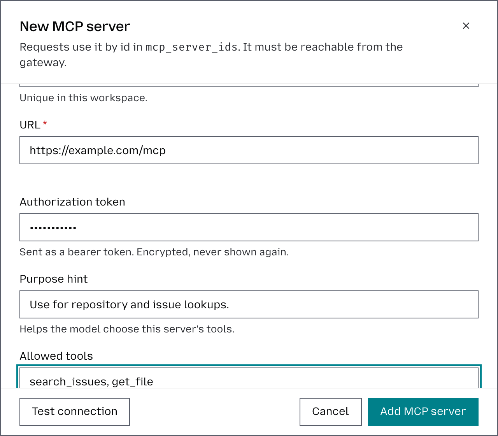

# Add an MCP server

MCP servers allow requests from a workspace to connect to external tools and services. Each server is configured at the **workspace level**, so you can control which MCP tools are available to requests within that workspace.

To add an MCP server:

1. Select the workspace in the top-left corner.
2. Go to **Tools** → **MCP servers**.
3. Click **Add MCP server**.
4. Enter a **Name** for the server. This must be unique within the workspace and is used to identify the server’s tools.
5. Enter the MCP server **URL**. The endpoint must be reachable from the Otari gateway.
6. Under **Credentials**, keep **Shared token** to send one token for the whole workspace, or choose **Each user signs in** to have every user connect their own account. The second is described in [Connect your account to an MCP server](connect-your-account-to-an-mcp-server.md).
7. With **Shared token**, enter an **Authorization token** if the server requires one.
8. Optionally, add a **Purpose hint** describing when the model should use this server, for example, “Use for repository and issue lookups.”
9. Under **Allowed tools**, specify which tools from the MCP server the model can access. Enter the tool names separated by commas, or leave the field blank to make all tools offered by the server available.
10. Use **Enabled** to control whether the MCP server is available for requests. You can disable it without removing its configuration.
11. Under **Default policy**, choose **Allow** to let every key in the workspace use the server, or **Deny** to let none use it until you add rules for them.
12. Click **Add MCP server** to save it.

Once added, the MCP server becomes available to requests in that workspace according to the configuration and allowed tools you defined. To limit it to some keys or users, see [Control access to an MCP server](control-access-to-an-mcp-server.md). How requests use MCP servers is described in [MCP](mcp.md).
