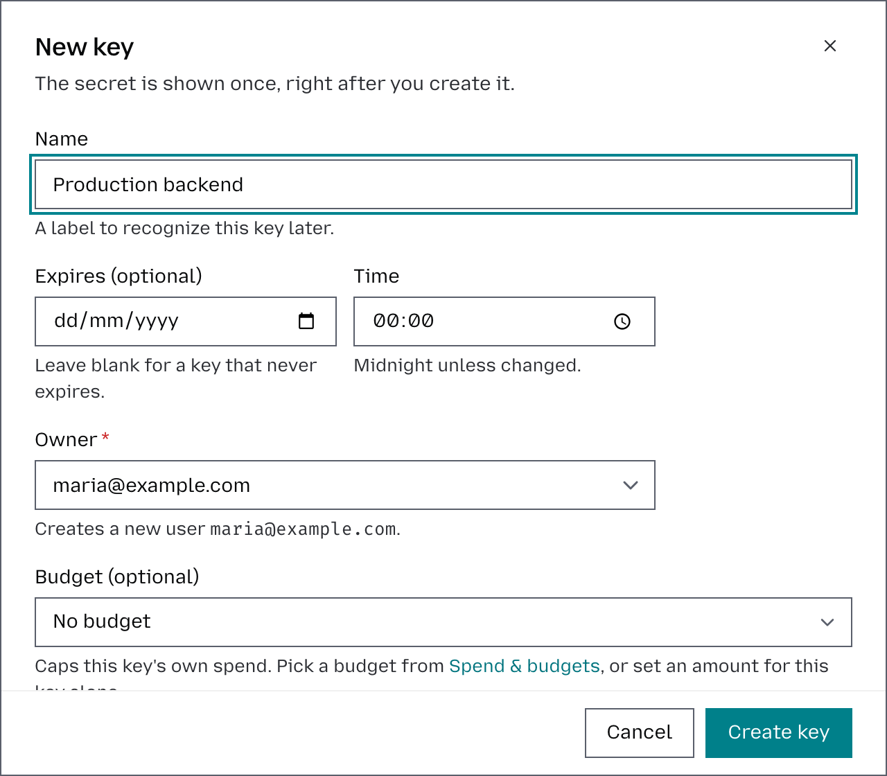

# API keys

An API key is the credential an application sends to Otari. It belongs to one
workspace and one user, so it decides where a request's usage and spend land.
What a key can carry, and who may manage which keys, is under
[How it works](#how-it-works).

Send the key as a bearer token (`Authorization: Bearer <key>`); the other
accepted headers are in [Authentication](api-reference.md#authentication). The
base URL to send it to, and the form each SDK expects, are in
[Base URL](api-reference.md#base-url).

## Create a key

1. Open the workspace's **API keys** page and click **Create key**.
2. Enter a **Name** and, optionally, an expiry under **Expires (optional)**.
3. Optionally, click **Advanced** to narrow the models the key can use. By
   default a key inherits your model access, and it can never exceed it; see
   [Model and search tool access](#model-and-search-tool-access).
4. Click **Create key**, then copy the key. It is shown once, so store it
   before you close the dialog.

## Cap a key's spend

An organization owner or admin, or a deployment operator, can give a key a
budget of its own: in the key's create or edit form, pick an existing budget under
**Budget (optional)**, or set a **Limit (USD)** and how often it **Resets**. The
key's owner's budget still applies beside it. The page's Budget column shows
each key's spend this period against its limit. For budgets in general, see
[Budgets](budgets.md).

## Accept or reject mismatched `user` fields

When the client behind a key puts something other than the key's own user in
the request's `user` field (Claude Code does), choose what the key does with it:
use the deployment setting, always reject, or always accept. What each choice
does is in [Mismatched `user` fields](#mismatched-user-fields).

Set the value in the dashboard's key form (under **Advanced** when creating a
key, and on the edit form), or as `reject_user_mismatch` on `POST` or `PATCH`
`/api/v1/organizations/me/keys`. Self-hosted deployments can also set it on a key
declared in config.yml, and change the deployment-wide default; see
[Budgets and API keys in config](configuration.md#budgets-and-api-keys-in-config).

## Regenerate or delete a key

- **Regenerate** on a key's row issues a new secret and keeps the key record.
  The current secret stops working immediately, with no grace period. The new
  plaintext is shown once, as on creation.
- **Delete** on a key's row removes the key permanently.

On a self-hosted deployment, a key declared in config.yml behaves differently;
see [What config.yml owns](configuration.md#what-configyml-owns).

## How it works

### What a key carries

Each key has a fixed user and workspace and may also define:

- expiration and active status
- allowed models (see [Model and search tool access](#model-and-search-tool-access))
- budget exemption
- a budget of its own: a spend ceiling on the key, which its owner's budget does
  not replace (both apply)
- whether mismatched client `user` fields are accepted (see
  [Mismatched `user` fields](#mismatched-user-fields))
- whether content-free agent telemetry is captured
- whether it is a service key, which may name end users (see
  [Track spend per end user](end-users.md))
- application metadata

A budget-exempt key is also exempt from `require_pricing`. Reserve such keys for
usage import or other intentional observability-only traffic.

A backend on Google Cloud, or behind another OpenID Connect issuer, can
authenticate as a key with its platform identity token instead of the key's
secret, once the operator trusts the issuer and gives the key a federation
rule. With `federation_member_rules` on, an organization owner or admin can give
their own key one instead; see [Workload identity](workload-identity.md).

### Who manages which keys

Organization owners, admins and members manage their own keys on the
workspace's **API keys** page, or at `/api/v1/organizations/me/keys`. That route
derives the owner rather than accepting one, so a member's keys are always their
own and billed to them. It mints only into a workspace the caller may see, and
never issues a budget-exempt key. It refuses a field it does not take, such as
`user_id` or `exclude_from_budget`, with `422` rather than ignoring it. An
organization owner or admin also makes the organization's own service keys on
this route; see
[An organization's own service keys](end-users.md#2-create-the-service-key).

A viewer may list their keys there and is refused (`403`) every write:
creating, editing, rotating or deleting a key takes organization owner or
admin, or a caller who is a viewer neither of the organization nor of the key's
workspace. To give a viewer a key, an operator issues it and owns its changes.

A deployment operator manages every key in the organization at `/api/v1/keys`
and chooses each key's owner; on a self-hosted deployment, see
[Deployment-wide account administration](sign-in.md#deployment-wide-account-administration).

A key records whether its owner minted it on the member surface or an operator
issued it. Membership changes act on that:

- Removing someone from a workspace, or from the organization, switches off every
  key billed to them there. So does an operator switching a key off on
  `/api/v1/keys`. Its owner may then delete it or keep it off, but only an
  operator can switch it back on.
- Making someone a viewer, of a workspace or of the organization, switches off
  the keys they minted for themselves there, and leaves the keys an operator
  issued them alone. Promoted again, they may switch their own keys back on.
- A key minted before this was recorded has no origin on file and is left alone
  by a demotion. An operator who demotes someone to viewer should check the keys
  billed to them.

### Model and search tool access

A user's `allowed_models` is inherited by newly created keys unless the key
defines its own list. A missing list allows any model, an empty list allows none,
and entries may use provider wildcards such as `openai:*`.

Search and fetch tools have a list of their own, `allowed_tools`, which governs
`POST /api/v1/search` and `POST /api/v1/fetch`; the in-loop `otari_web_search` and
`otari_web_fetch` tools, which run on the same tools, do not read it. Its entries
are search or fetch tool names, as `search_tools`, `fetch_tools` or the dashboard
names them, `builtin_fetch` for the gateway's own fetcher, or `*` for every tool,
and no wildcard in `allowed_models` reaches a tool: a search provider can share
its name with a model provider, as DeepSeek does, and `deepseek:*` is for
DeepSeek's models. A key's own `allowed_tools` wins over its user's, and a key may
narrow its user's list but never broaden it. An empty list allows no tool.

With no `allowed_tools` on the key or its user, the search tools are read off the
model list: a key unrestricted for models may run any search or fetch tool, and a
key restricted for models may run only the search tools its `allowed_models`
names whole as `<provider>:<tool>`, such as `exa:exa-search`, and that its user's
model list grants too; no model list grants a fetch tool. That form is
deprecated, and a later release removes it; give the key or user an
`allowed_tools` list instead. A wildcard no longer grants a search tool. A model
list no longer takes a
wildcard or another name under a provider that serves only search tools, such as
`exa:*`; it takes that provider's exact `<provider>:<tool>` keys alone.

When a user is first given `allowed_tools`, each of their keys that has a model
list of its own and no `allowed_tools` is set to the tools it could run before
that are also on the user's new list, so moving a user off the deprecated form
never widens a key that had narrowed its search away. A list sent back unchanged,
as the dashboard's edit forms do, is not checked again, so a key or user naming
a tool deleted since still saves an unrelated change. No search tool may be
named `*`.

### Mismatched `user` fields

A request can name a user: `user` on Chat Completions, Responses and the
pass-through routes, `metadata.user_id` on Messages. On an ordinary key that
value may only be the key's own user; anything else is refused with `403`. A
key's `reject_user_mismatch` changes that for the key alone:

| Value | Dashboard choice | A request naming another user |
| --- | --- | --- |
| `null` (default) | Use the deployment setting | Follows the deployment-wide `reject_user_mismatch`, which rejects unless changed |
| `true` | Always reject (403) | Rejected, even where the deployment accepts |
| `false` | Always accept | Accepted, and billed to the key's user |

Spend binds to the key's own user whichever value applies, so accepting a
mismatch never lets a key charge someone else.

Accept mismatches on a key whose client puts something other than an Otari
user ID in that field. Claude Code sends a telemetry value there (see
[Use with Claude Code](use-with-claude-code.md)). So does an application that
sends every request on one key and passes its own end user's ID. That
application has two choices:

- Accept mismatches, and every request bills the key's user: one budget for
  the whole application.
- Make the key a [service key](end-users.md), and each ID becomes an end user
  with spend and a budget of its own.
