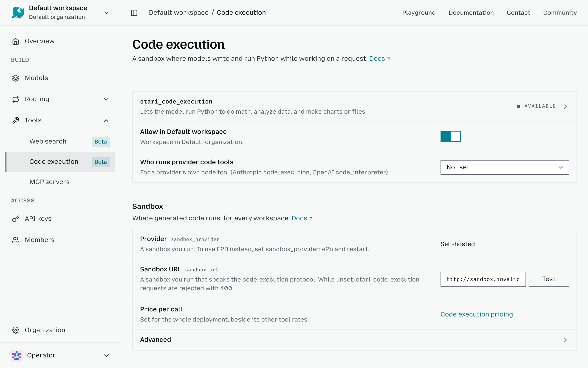

# Code execution

The **Code execution** settings let you control whether requests from a workspace can run generated code in a sandbox. You can apply more restrictive settings than the deployment to individual workspaces.

To configure code execution for a workspace:

1. Select the workspace in the top-left corner.
2. Go to **Tools** → **Code execution**.
3. Turn **Allow in <workspace>** on to allow code execution for requests in this workspace, or off to block it.
4. Configure **Who runs provider code tools** to control whether supported provider-native code tools or the Otari sandbox handle execution.

Where the operator offers more than one sandbox environment, such as Python with
or without data libraries, a workspace can be pinned to one through the
workspace policy API, and a direct run can choose one. See
[Sandbox environments](tools.md#sandbox-environments).
