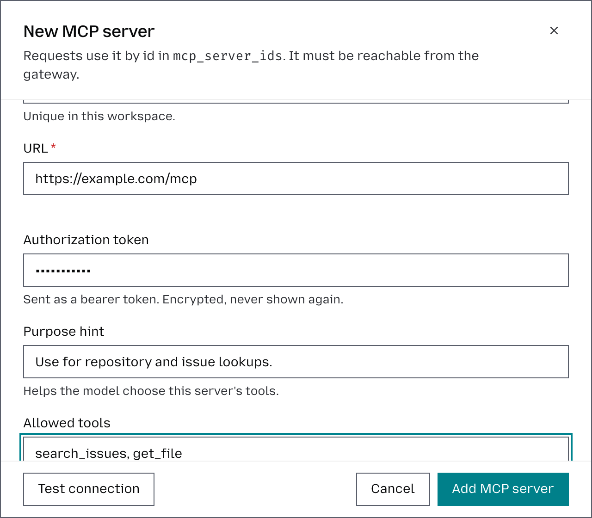

# Configure an MCP server

MCP servers allow requests from a workspace to connect to external tools and services. Each server is configured at the **workspace level**, so you can control which MCP tools are available to requests within that workspace. How requests use MCP servers is described in [MCP](mcp.md).

## Connect a server

1. Select the workspace in the top-left corner.
2. Go to **Tools** → **MCP servers**.
3. Click **Add MCP server**.
4. Enter a **Name** for the server. This must be unique within the workspace and is used to identify the server’s tools.
5. Enter the MCP server **URL**. The endpoint must be reachable from the Otari gateway.
6. If required, enter an **Authorization token**.
7. Optionally, add a **Purpose hint** describing when the model should use this server, for example, “Use for repository and issue lookups.”
8. Under **Allowed tools**, specify which tools from the MCP server the model can access. Enter the tool names separated by commas, or leave the field blank to make all tools offered by the server available.
9. Use **Enabled** to control whether the MCP server is available for requests. You can disable it without removing its configuration.
10. Under **Default policy**, choose **Allow** to let every key in the workspace use the server, or **Deny** to let none use it until you add rules for them.
11. Click **Add MCP server** to save it.

Saving opens the server's page, where its access rules live.

## Control who can use it

Unless its default policy is **Deny**, a server is open to every key in its
workspace. Its access
list (ACL) decides which keys and users can reach it, and which of its tools they
may run. The rules are described in [Server access](mcp.md#server-access).

You need to be an owner or admin of the workspace or of the organization. Start
from the server's page: select the workspace in the top-left corner, go to
**Tools**, then **MCP servers**, and click the server.

### Choose the default policy

The default policy applies to every key that no rule names.

1. Under **ACL**, find the **Default policy** row and click **Edit**.
2. Under **Action**, choose **Allow any tool** to keep the server open, or
   **Deny** to close it to every key you do not name in a rule.
3. Click **Save rule**.

### Add a rule for a key or a user

1. Under **ACL**, click **Add rule**.
2. Under **Source**, pick the keys or users the rule is for. A user covers every
   key they own, including keys they create later.
3. Under **Action**, choose **Allow any tool**, **Read tools only**,
   **Allow specific tools…** or **Deny**.
4. Click **Add rule**.

A rule for a key wins over a rule for its user, and either wins over the default
policy. Adding a rule for a key or user that already has one replaces it.

### Let a key only read

**Read tools only** allows the tools labeled as read on that server. A server
starts with none labeled, so label them first.

1. Under **Read tools**, click **Edit**.
2. Tick the tools that only read. Tools the server itself marks as read-only are
   suggested, but none counts as read until you save.
3. Click **Save read tools**.
4. Add a rule for the key with **Read tools only**, as above.

A tool you label as read later is allowed without changing the rule.

### Check what a key can reach

- Under **Trace a call**, pick a **Source key**, enter a **Tool**, and click
  **Trace**. It shows whether the key may call the tool and which rule decided.
- On the **API keys** page, edit a key: **MCP access** lists what it reaches on
  each of the workspace's servers.

A denied key is told the server does not exist, so check here before assuming
the server id is wrong.

## Keep requests on stored servers

A request can also name an MCP server by URL, with its own token, and no ACL
covers those. To allow only the workspace's own servers, turn
**Let requests name their own MCP servers** off on the **MCP servers** page. A
new workspace starts with it off.

**Exposed tools**, on the server's page, applies before the ACL: a tool the
server does not expose is out of reach whatever a rule says.
