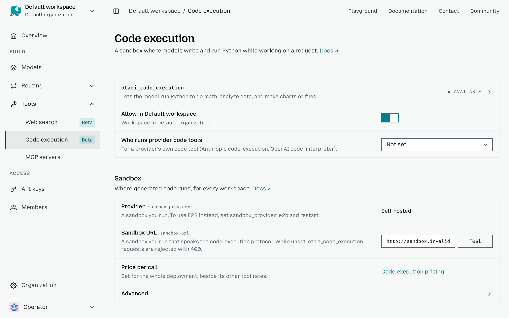

# Configure code execution

The **Code execution** settings let you control whether requests from a workspace can run generated code in a sandbox. You can apply more restrictive settings than the deployment to individual workspaces.

To configure code execution for a workspace:

1. Select the workspace in the top-left corner.
2. Go to **Tools** → **Code execution**.
3. Turn **Allow in <workspace>** on to allow code execution for requests in this workspace, or off to block it.
4. Configure **Who runs provider code tools** to control whether supported provider-native code tools or the Otari sandbox handle execution.

Workspace settings can restrict what is allowed at the deployment level, but they **cannot enable code execution if no sandbox has been configured for the deployment**.

The prompt hint, the tool-loop iteration cap, the execution timeout, and the sandbox image are set through the API; see [Per-workspace code policy](tools.md#per-workspace-code-policy).
