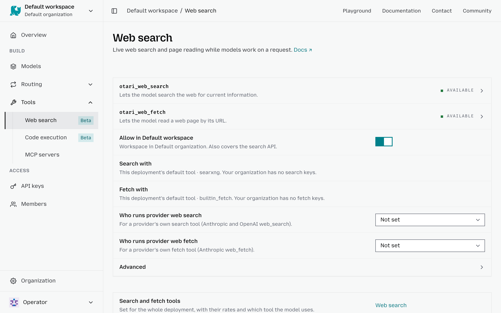

# Configure web search

The **Web search** settings let you control how requests from a workspace can access and search the web. You can customize web access for individual workspaces, including which keys searches use, which domains can be accessed, and how many results a search can return.

To configure web search for a workspace:

1. Select the workspace in the top-left corner.
2. Go to **Tools** → **Web search**.
3. Turn **Allow in <workspace>** on to allow web search for requests in this workspace, or off to block the web search and fetch tools Otari runs.
4. Under **Search with** and **Fetch with**, choose which of the organization's keys the workspace uses, or a default. Only an owner or admin can change these.
5. Under **Who runs provider web search** and **Who runs provider web fetch**, choose whether a provider's own search and fetch tools run on the provider or on Otari, or leave them **Not set**.
6. Under **Advanced**, set **Max results for this workspace** to limit the number of results returned by each search.
7. Use **Allowed domains** to restrict searches and fetched content to specific websites.
8. Use **Blocked domains** to prevent searches and fetches from accessing specific websites.

Workspace settings can make the deployment-level web search policy more restrictive, but they **cannot override it to allow access that has been blocked at the deployment level**.

For the full policy, including the prompt hint, which is set through the API, see [Per-workspace web-access policy](tools.md#per-workspace-web-access-policy).
