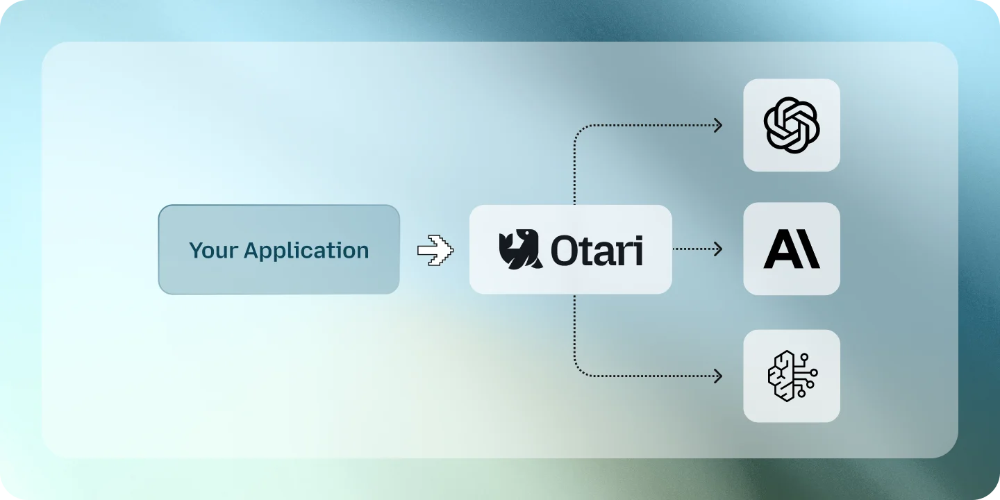
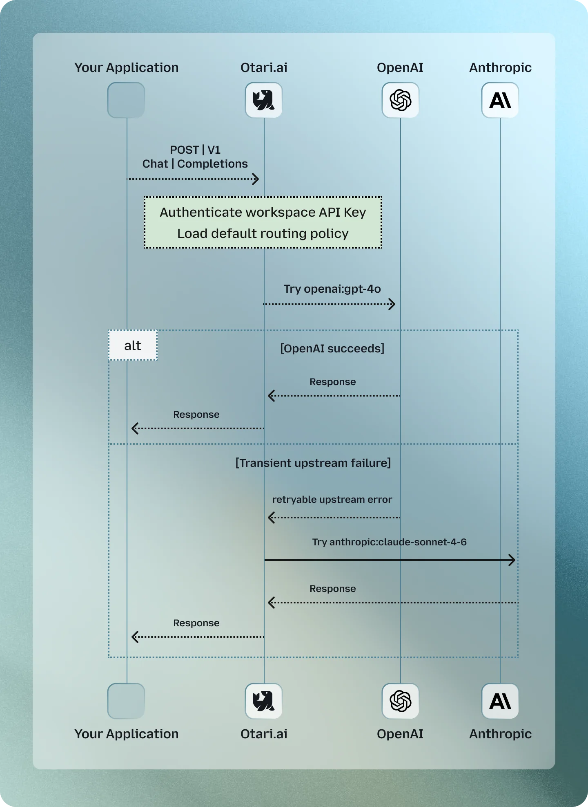

# Create a multi-provider routing

Otari sends your requests to models from several providers through one
endpoint, and moves to the next one when a provider fails. Your application
sends one request with one key; Otari picks the provider behind it.

This guide sets up a fallback from OpenAI to Anthropic on otari.ai. The same
steps work for any of the 40+ providers Otari supports, such as Amazon Bedrock,
Azure OpenAI, Mistral or Gemini.

## Provider keys and API keys

Two kinds of key are involved, and they do different jobs:

- A **provider key** is your upstream credential, such as your OpenAI or
  Anthropic API key, stored in Otari.
- An **API key** belongs to a workspace, and is what your application sends to
  Otari.

Your application sends its API key to Otari, and Otari calls the provider with
the provider key. The application never sees the provider's secret.

## What changes with Otari

Without Otari, your application has to know which provider to call, how to
authenticate with it, what its model is called there, and what to do when the
call fails, once for every provider it uses.

With Otari, it sends every request to one endpoint,
`https://api.otari.ai/api/v1/chat/completions`, and the routing lives in Otari.
Accounts in otari.ai's EU region use `https://eu.api.otari.ai/api/v1` instead;
`api.otari.ai` answers an EU key with `421 Misdirected Request`, naming the host
to use.



## What you need

- An otari.ai account, and a workspace to route requests from; see
  [Manage workspaces](manage-workspaces.md).
- To be an owner or admin of the organization, to add provider keys and
  routing policies.
- Provider keys for two providers, if you want the requests billed by them
  rather than paid from your otari.ai balance; see
  [Manage provider keys](manage-provider-keys.md).

## 1. Add your provider keys

1. Click **Organization**, then select **Providers**.
2. Click **Add provider key**, select **OpenAI**, give the key a name, paste
   it, and save it.
3. Do the same for **Anthropic**.
4. Check that the workspace you will use can use both keys; see
   [Control which keys a workspace uses](manage-provider-keys.md#control-which-keys-a-workspace-uses).

You can skip this step: a policy entry with no key of yours behind it is served
by otari.ai and paid from your organization's balance, at the same rate as a
direct request. When the balance cannot cover it, Otari skips that entry and
tries the next.

## 2. Create a workspace API key

1. Select the workspace in the top-left corner.
2. Open **API keys** and click **Create key**.
3. Copy the key. It is shown only once.

```bash
export OTARI_API_KEY=tk-your-api-key
```

This is the only credential your application needs.

## 3. Create a routing policy

A routing policy is a model name your application sends, which Otari resolves to
one or more real models.

1. In the workspace, open **Routing**, then **Policies**.
2. Create a policy and choose what it does:
   - **Fallback**: one main model, with backups tried in order when it fails.
     This is the one this guide uses.
   - **Split traffic**: a weighted mix across models, such as 70% and 30%.
   - **Spill over at rate limits**: move to the next model when one is full.
   - **Tier down on budget**: switch to a cheaper model once the budget fills
     up.
3. Name it `production-chat`, choose an OpenAI model as the **Main model**, add
   an Anthropic model under **If unavailable, use**, and save it.

Otari tries the main model first. When it fails before its answer starts, from
an outage, a rate limit, a rejected key or an error, Otari moves on to the next
entry.



## 4. Send a request through the policy

Your application sends an ordinary OpenAI-compatible request, with the policy's
name as the model:

```bash
curl -i https://api.otari.ai/api/v1/chat/completions \
  -H "Authorization: Bearer $OTARI_API_KEY" \
  -H "Content-Type: application/json" \
  -d '{
    "model": "production-chat",
    "messages": [
      {"role": "user", "content": "Explain why multi-provider routing matters in two short sentences."}
    ]
  }'
```

The endpoint, the key and the request shape stay the same whatever the policy
does. To change providers later, you change the policy, not your application.

## 5. Check the result

The response keeps the policy's name in its `model` field. Its headers say what
served it:

- `Otari-Model`: the model that answered, such as `gpt-5-mini`.
- `Otari-Fallback`: `false` when the main model answered, `true` when a backup
  did.

The request is also listed in the workspace's **Overview**, on its **Requests**
tab, with its cost and the models Otari tried.

## Test the fallback

To see the fallback work, break the main model on purpose, for the test
workspace only. Every workspace that follows the organization uses its OpenAI
key, so do not break that one:

1. In **Organization**, then **Providers**, add an OpenAI key with an invalid
   value, named `fallback-test`.
2. Edit the test workspace and select **Always use this key** for
   `fallback-test`. Other workspaces keep the organization's key.
3. Send the same request again.

It still succeeds. This time `Otari-Fallback` is `true` and `Otari-Model` names
the Anthropic model: OpenAI refused the key, and Otari moved on to the backup.
The **Requests** tab records both attempts.

When you are done, set the test workspace back to **Follow the organization**
and remove the `fallback-test` key.

## A good first production setup

- One main model for your main workload, and a second model, from another
  provider, as its fallback.
- One routing policy per workload, which your application names as its model.
- One API key per environment or application.

That is enough to move from one provider to several without changing how your
application calls Otari. Every policy kind, and what each field does, is in
[Routing policies](routing.md).
