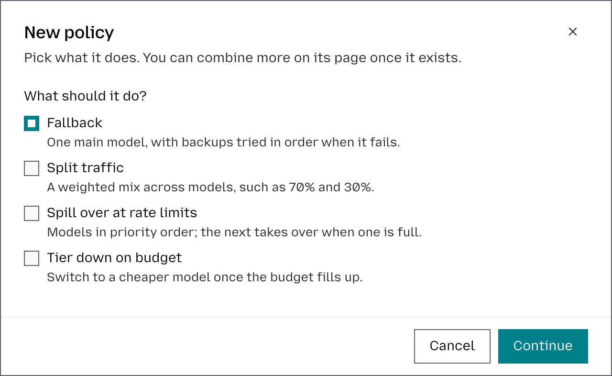
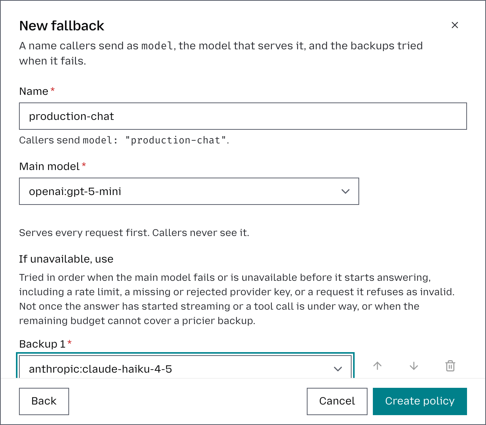

# Create a multi-provider routing

Otari routes requests across multiple providers through one OpenAI-compatible endpoint, with automatic failover when a provider fails. Your app sends one request with one key, and Otari handles provider selection behind it.

This guide sets up two providers, OpenAI and Anthropic, with a fallback chain, using hosted otari.ai.

Otari supports 40+ providers, including OpenAI, Anthropic, Amazon Bedrock, Azure OpenAI, Mistral, Gemini, and local models.

## Provider keys vs API keys

Before we get into setup, it helps to separate two similar-sounding concepts:

* **Provider keys** are your upstream credentials, like your OpenAI or Anthropic API key, stored in Otari.
* **API keys** are workspace-scoped keys your application uses to call Otari.

Your app sends an API key to Otari. Otari uses the provider key to call the upstream provider. Your app never sees the upstream secret.

## What changes with Otari

Without Otari, your app has to know which provider to call, how to authenticate, what model name to send, and what to do when your request fails. Rinse and repeat for each provider you use.

With Otari, your app sends one request to one endpoint: `https://api.otari.ai/api/v1/chat/completions` (`https://eu.api.otari.ai/api/v1/chat/completions` for an account in the EU region).

Otari resolves the route based on your workspace configuration and can move to the next provider in the chain when a transient upstream failure happens.


Your application talks to Otari once. Otari handles the provider-facing complexity.

## What you need

* A hosted otari.ai account
* A workspace where you want to route requests. For more info, also consult [Manage workspaces](manage-workspaces.md).
* Org admin access, if you want to add provider keys and manage routing policies
* Optionally, provider accounts and API keys for two providers. Without them, otari.ai serves the requests and they are paid from your balance. For more info, also consult [Manage provider keys](manage-provider-keys.md).

This example uses OpenAI and Anthropic because they make the routing story easy to follow. If your team uses Bedrock or Azure OpenAI instead, the flow is the same.

## 1. Add your provider keys

Start with bring-your-own-provider setup, because that is where multi-provider complexity usually begins.

1. From the main dashboard, click **Organization**.
2. Select **Providers**, then **Inference**.
3. Click **Add provider key** in the top-right corner.
4. Select the **Provider** from the dropdown, for example, **OpenAI**.
5. Enter a **Name** to easily distinguish multiple keys for the same provider, such as `production`, `staging`, or `backup`.
6. Paste your API key.
7. Click **Add provider key** to save it.
8. Repeat the process to add a second provider key, for example, **Anthropic**.
9. Make sure both keys are available to the workspace you want to use; see [Control workspace access](manage-provider-keys.md#control-workspace-access).
10. If you have multiple keys for the same provider, set the right default.

At this point, Otari knows how to reach both providers without your application needing to store either key.

You can skip this step: a policy entry with no key of yours behind it is served by otari.ai and paid from your balance.

## 2. Create a workspace API key

Next, create the credential your app will actually send to Otari.

1. Open the target workspace in the top-left corner.
2. Go to the **API keys** page.
3. Click **Create key**.
4. Copy the key immediately.

You can export it locally like this:

```bash
export OTARI_API_KEY=otk_...
```

This is the only credential your application needs to send requests through Otari.

## 3. Create a routing policy

The routing policies let you control how requests are routed across models and providers. A policy has a name, which your application sends as the model. When creating a policy, you can choose the routing strategy that best fits your needs:

1. Open the target workspace.
2. Open **Routing**, then **Policies**.
3. Click **Create policy**.
4. Choose the routing strategy:
   * **Fallback**: Define the ordered list of models to use if the main model call fails, helping keep requests running when a model or provider is unavailable. This is the routing option we’ll be testing in this guide.
   * **Split traffic**: Distribute requests across multiple models based on the percentage weights you define.
   * **Spill over at rate limits**: Move to the next model when one hits its rate limit.
   * **Tier down on budget**: Automatically switch to a cheaper model when spending reaches a defined threshold, such as 80% of your budget.

   

5. Give it a name like `production-chat`, choose an OpenAI model as the **Main model**, and add an Anthropic model under **If unavailable, use**.
6. Save the policy.



When defining a fallback chain, Otari will try the first entry first. If the request hits a transient upstream issue before its answer starts, such as a timeout, 5xx response, rate limit, or bad credentials, it can move to the next configured entry automatically.


The important part is that your application still makes the request. The routing policies live in Otari, not in your app code.

## 4. Send your first routed request

Once the fallback routing policy is in place, your app can send a normal OpenAI-compatible request to Otari, with the policy's name as the model.

```bash
curl -i https://api.otari.ai/api/v1/chat/completions \
  -H "Authorization: Bearer $OTARI_API_KEY" \
  -H "Content-Type: application/json" \
  -d '{
    "model": "production-chat",
    "messages": [
      {"role": "user", "content": "Explain why multi-provider routing matters in two short sentences."}
    ]
  }'
```

The request format stays simple:

* one endpoint
* one auth pattern
* one request shape

What changes is the control plane behind it. Otari resolves the route for the workspace and applies the policy you configured.

## 5. Verify the result

After the request succeeds:

1. Open the same workspace.
2. Go to the Overview and its Requests tab.
3. Confirm the request appears there.

The Requests tab records the request and its cost, so spend across all providers is visible in one place.

The response's `Otari-Model` header names the model that answered, and `Otari-Fallback` says `true` when a backup did.

## Why this matters in practice

Multi-provider routing is not just a nice-to-have abstraction. It changes how you operate AI in production.

* You stop hardcoding provider choices into application logic.
* You can swap providers without rewriting every caller.
* You can keep upstream credentials out of your application code and deployment config.
* You can add resilience without building your own retry and fallback layer.
* You get one place to manage provider access, request visibility, and spend controls.

## Test the fallback

So far, every request has succeeded on the primary, so you haven't seen the fallback do anything yet. You can trigger it on purpose to confirm the chain works.

Temporarily break the primary for a test workspace only, then send the same request:

1. In **Organization** → **Providers** → **Inference**, add an OpenAI key with an invalid value, named `fallback-test`. Leave the Anthropic key valid.
2. Pin the test workspace to `fallback-test`, as in [Control workspace access](manage-provider-keys.md#control-workspace-access). Other workspaces keep the organization's key.
3. Send the same `production-chat` request from step 4, unchanged.

The request still succeeds, but the response now comes from Anthropic. OpenAI refused the key, Otari moved to the next entry, and Anthropic served the call. `Otari-Fallback` is now `true`, and `Otari-Model` names the Anthropic model. The Requests tab records both attempts.

When you're done, remove the `fallback-test` key so the test workspace follows the organization's key again.

## A good first production pattern

If you want a practical starting point, use this setup:

* A primary model to serve as the default route for your main chat workload.
* A second model, from another provider, as the fallback route for transient failures.
* One routing policy per workload, which your application names as its model.
* One workspace API key per environment or application.

That is enough to move from a single-provider setup to a real multi-provider architecture without changing your application contract. Every policy kind is described in [Routing policies](routing.md).

## Make your first routed request

If you already have provider keys for two vendors, you are closer than you think.

Add the keys once, create one workspace API key, define one routing policy, and send one request through otari.ai. That is the moment Otari starts paying off: your app keeps one interface, while your infrastructure becomes more flexible, more resilient, and easier to maintain.
