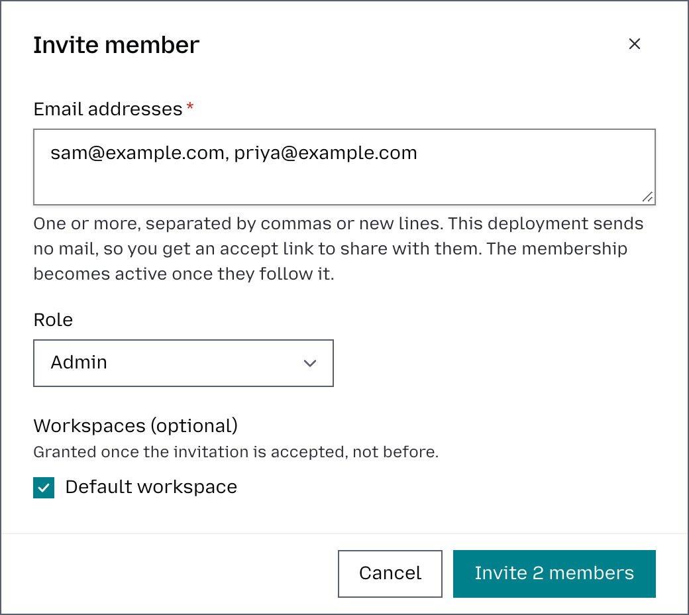

# Invite and manage organization members

Organization **Admins and Owners** can invite other members to collaborate and control which workspaces they can access. This makes it easy to give each person access only to the areas relevant to their work.

## Invite a member

1. Go to **Organization** → **Members & roles**.
2. Click **Invite member**.
3. Enter one or more **Email addresses** separated by commas or new lines.
4. Select the **Role** you want to assign: Owner, Admin, Member, or Viewer.
5. Choose the workspaces the new member should have access to.
6. Click **Invite member**. The user will receive an invitation by email, and their membership will become active once they accept it. When no email goes out, the dialog shows an accept link to share with them instead.

## Manage existing members

Admins and Owners can also manage existing members. You can **change a member’s role**, update **which workspaces they can access**, or **remove them from the organization** when access is no longer needed. An invitation that has not been accepted yet can be reissued or revoked from its row.

Roles have predefined permissions. Owners and Admins can manage the organization, including its workspaces, provider keys, guardrails, pricing, and members, and have full access to usage data. Members and Viewers can access the workspaces they’ve been assigned to. See [Roles](workspaces.md#roles) for the full table, and [Members and invitations](members.md) for bulk invitations and email-domain auto-join.
