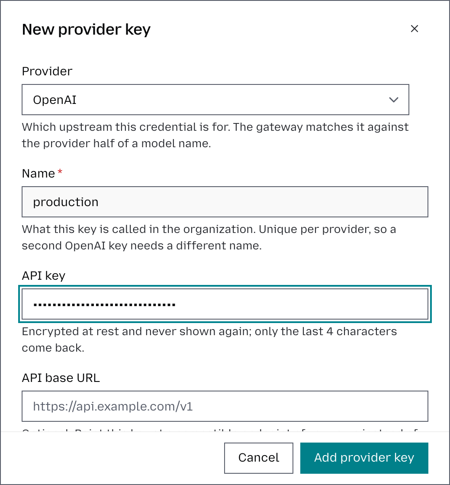
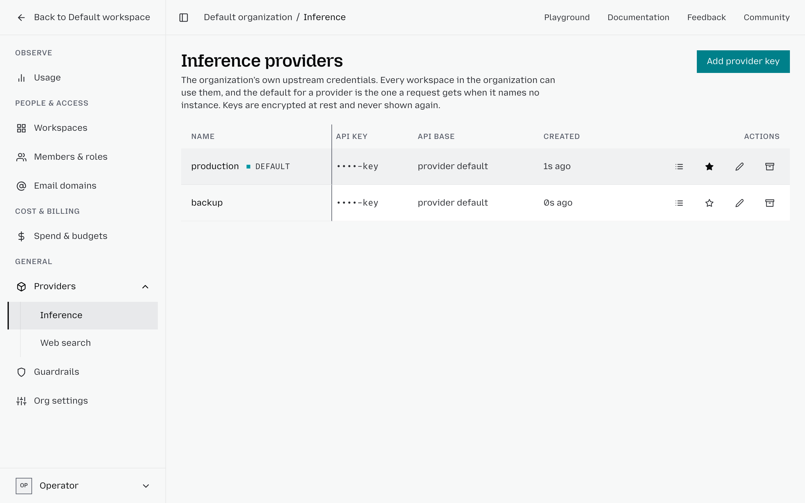
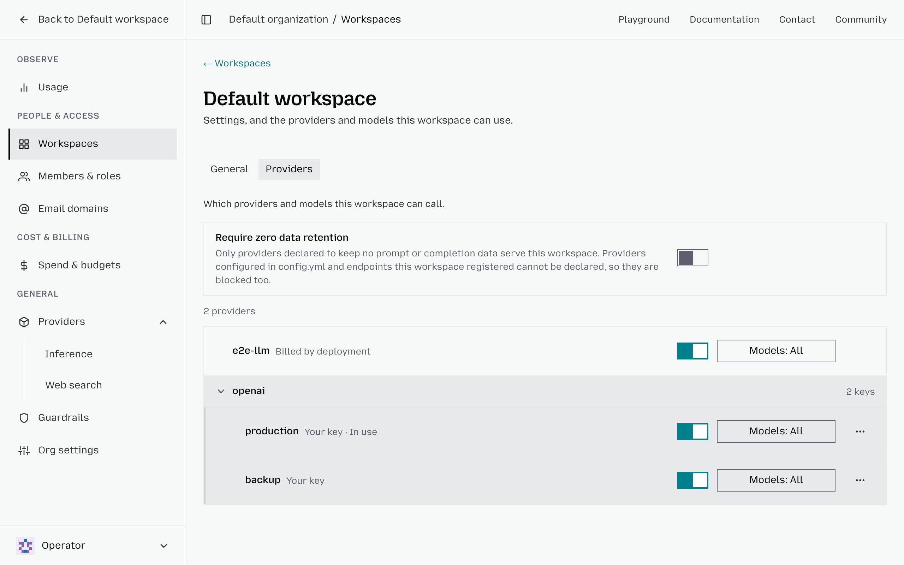

# Manage provider keys

A provider key is the credential Otari uses to call a model provider, such as
your OpenAI or Anthropic API key. Your applications never see it: they send an
Otari [API key](api-keys.md), and Otari calls the provider with the provider key.

## Choose how you reach a provider

You do not need a provider key of your own to start. Two ways work side by side:

- **otari.ai's own keys.** Without any setup, requests can use models otari.ai
  provides. otari.ai holds the upstream credential, and the requests are paid
  from your organization's balance; see [Billing](billing.md).
- **Your own keys.** Add a provider key you already have, and Otari uses it on
  your behalf. The provider bills you directly, and Otari adds no per-token
  charge.

When your organization has a key of its own for a provider, Otari uses it
first.

## Add your own provider key

1. Click **Organization**, then **Providers**, then **Inference**.
2. Click **Add provider key** in the top-right corner.
3. Select the **Provider**.
4. Enter a **Name** that tells several keys for one provider apart, such as
   `production`, `staging` or `backup`.
5. Paste the provider's API key.
6. For a compatible endpoint of your own (Synthetic, a vLLM server), enter its
   **API base URL**. Requests then reach this key's models by its **Request
   prefix**, such as `synthetic:hf:Qwen/Qwen3.8-27B`, rather than by the
   provider's name; see
   [Add a key for your own endpoint](provider-keys.md#add-a-key-for-your-own-endpoint).
7. Click **Add provider key** to save it.

## Set a default key per provider

When a provider has several keys, mark one as the default so workspaces use it
without further setup. On **Inference**, click **Make default provider** (the star
icon) on the key.

## Control which keys a workspace uses

Every workspace follows the organization's default key for each provider unless
you choose otherwise. Open **Organization**, then **Workspaces**, open the
workspace from the list, and select its **Providers** tab. Each key there has:

- A switch: turn it off to keep the workspace off this key.
- **Models**: limit which of the provider's models the workspace may use with
  this key.
- **Always use this key**, in the key's **More** menu: pin the workspace to
  this key, even after the organization's default changes.

A key you leave as it is follows the organization. To undo a pin, choose **Stop
always using this key** in the same menu, and the workspace follows the
organization's default again.

To replace a key without breaking anything, see
[Rotate a provider key](rotate-a-provider-key.md). More detail is in
[Provider keys](provider-keys.md).
