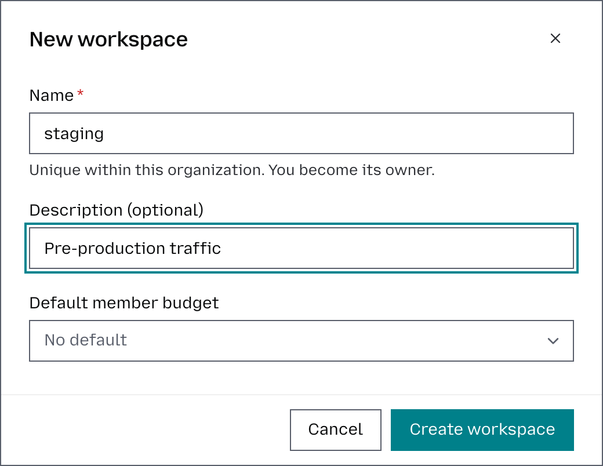
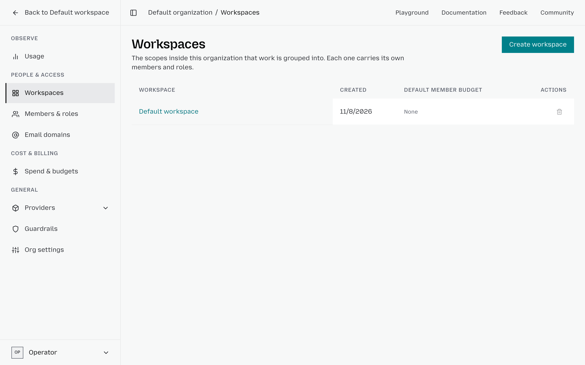

# Manage workspaces

For background on what workspaces are and how they fit into the organization, see [Organizations and workspaces](workspaces.md).

## Create a workspace

1. From the main dashboard, click **Organization** in the bottom-left corner, then **Workspaces**.
2. Click **Create workspace**.
3. Give it a name, an optional description, and create it.

Workspaces inherit all provider keys available at the organization level. If a provider has multiple keys, you can choose which one a specific workspace should use, and which of its models the workspace can call.

To select which provider keys a workspace can use, open the workspace from the list and select its **Providers** tab; see [Control workspace access](manage-provider-keys.md#control-workspace-access).

## Manage a workspace

From the main dashboard, select the workspace in the top-left corner. Its menu has **Overview**, **Models**, **Routing**, **Guardrails**, **Tools**, **API keys** and **Members**.

Click **Organization** at the bottom of the menu, then use the sidebar to move between different areas:

* **Usage**: for analytics and request history.
* **Members & roles**: to invite members and manage their workspace-specific access.
* **Spend & budgets**: to define how much can be spent and over what period. To enforce the budget, you need to create a **spend ceiling** that applies it to an organization or workspace.
* **Providers**: to manage provider-key access. All workspaces within the organization can use the credentials for connecting to model providers, but you can also choose which provider keys a workspace can use (see **Create a workspace**, above).
* **Guardrails**: to check the content users send to a model. Each guardrail can be applied to specific workspaces and configured to either block requests that meet its conditions or record them for monitoring without blocking them.

## Organize workspaces by environment

For naming conventions and team patterns, see [How teams use workspaces](workspaces.md#how-teams-use-workspaces).

## Delete a workspace

1. From the main dashboard, click **Organization** in the bottom-left corner, then **Workspaces**.
2. Find the workspace you want to delete, click **Delete** (the bin icon), and confirm the deletion.

A workspace that still holds API keys, aliases, routing policies, or usage cannot be deleted, and neither can the organization's last workspace; see [Constraints worth knowing](workspaces.md#constraints-worth-knowing).

Move any apps that still use this workspace before you delete it.
