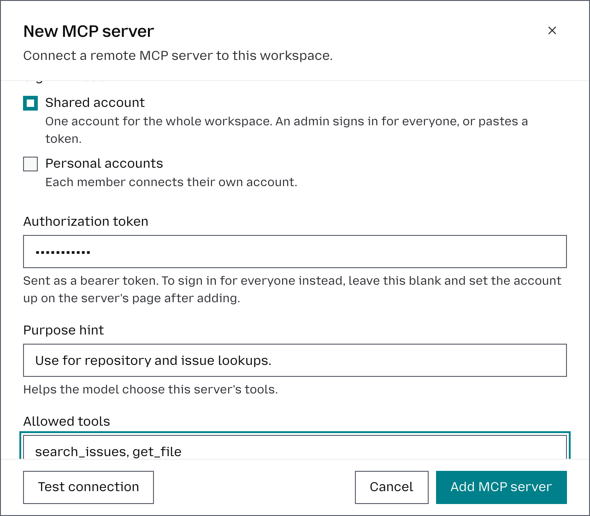

# MCP servers

MCP servers allow requests from a workspace to connect to external tools and services. Each server is configured at the **workspace level**, so you can control which MCP tools are available to requests within that workspace. How requests use MCP servers is described in [MCP](mcp.md).

## Connect a server

There are two ways in: add a server by its URL, or pick servers from the catalog. The steps below add one by URL.

1. Select the workspace in the top-left corner.
2. Go to **Tools** → **MCP servers**.
3. Click **Add MCP server**.
4. Enter a **Name** for the server. This must be unique within the workspace and is used to identify the server’s tools.
5. Enter the MCP server **URL**. The endpoint must be reachable from the Otari gateway.
6. Under **Sign-in mode**, keep **Shared account** to use one account for the whole workspace, or choose **Personal accounts** to have every member connect their own account. The second is described in [Connect your account to an MCP server](connect-your-account-to-an-mcp-server.md).
7. With **Shared account**, enter an **Authorization token** if the server takes one. If it only offers a sign-in, leave the field blank: you sign in for everyone on the server's page once it is added. See [Set up a Shared server's account](#set-up-a-shared-servers-account).
8. Optionally, add a **Purpose hint** describing when the model should use this server, for example, “Use for repository and issue lookups.”
9. Under **Allowed tools**, specify which tools from the MCP server the model can access. Enter the tool names separated by commas, or leave the field blank to make all tools offered by the server available. With **Shared account**, you can test the connection first and pick them from the tools the server offers instead.
10. Under **Availability**, choose who gets the server:
    - **Off**: nobody can use it. You can turn it on later without setting it up again.
    - **On request**: available to people building things, invisible to coding agents. Only requests that ask for it by its id get it; the **Server ID** is at the top of the server's page, and goes in `mcp_server_ids`.
    - **Every request**: available everywhere. It is added to every model request made with the workspace's keys, including coding agents such as Claude Code that never name a server. See [Attached to every request](mcp.md#attached-to-every-request).
11. Under **Default policy**, choose **Allow** to let every key in the workspace use the server, or **Deny** to let none use it until you add rules for them.
12. Click **Add MCP server** to save it.

Saving opens the server's page, where its access rules live. **Availability**
can be changed there at any time.

The top of the page says whether the server is **Shared** or **Personal**. To
change that, or its name, URL, token or OAuth client, click **Settings** there
and then **Save**. Under **Sign-in mode**, choose **Shared account** or **Personal
accounts**. Switching ends every sign-in the server holds: each member's own
connection, or the shared account.

**Delete server** is at the bottom of **Settings**. It removes the server for
everyone in the workspace and ends every connection to it, after you confirm.

Each server shows its logo, which the gateway finds from the server's address,
or its first letter. To use your own, click the logo on the server's page:
upload a PNG or SVG and choose whether it sits on a tile. See
[Logos](mcp-catalog.md#logos).

## Set up a Shared server's account

A **Shared** server sends one credential for every caller. The **Shared
account** section at the top of its page says which one it has, and offers two
ways to give it one:

- **Sign in for everyone.** The server's own sign-in opens in a small window.
  Sign in with the account the whole workspace should use. The page then reads
  **Signed in by** your name and the date, with **Reconnect** and
  **Disconnect**. Otari renews this sign-in on its own, as it does a member's.
- **Paste a token.** Opens **Settings** and puts the cursor in its
  **Authorization token** field.

Everyone in the workspace acts as the account you sign in with, on every key
and in the Playground. Use a service account rather than your own, so the
workspace does not read and write as you, and does not lose the server when
your access changes.

A server holds one of the two. Signing in for everyone removes a stored token,
and saving a token signs the shared account out.

A server that asks for an account and has none reads **Not set up yet**. The
list says **Not set up** in its **Connections** column, requests skip it the way they
skip a server that is **Off**, and members do not see it. A server that answers
without an account is never held back.

Only owners and admins of the workspace or of the organization can sign in for
everyone or disconnect the account. Signing in needs `public_base_url` and
`OTARI_SECRET_KEY` set, and an `https://` server URL, as a member's own sign-in
does. If the server does not let Otari register itself, add an OAuth client ID
first: see
[If the server does not let Otari register itself](connect-your-account-to-an-mcp-server.md#if-the-server-does-not-let-otari-register-itself).

## Read the list

Two columns say how each server signs in and what stands behind that:

- **Sign-in** is **Shared account**, one account for the whole workspace, or
  **Personal accounts**, each member's own.
- **Connections** depends on which. A shared server reads **Set up**, **Not set
  up**, **No account needed** when its last check got an answer without one, or
  **No account set up** while no check has. A personal server
  reads how many members connected their own account, such as **3 members** or
  **No one yet**, and ends in **including you** when you are one of them.

## Answer members' requests

A member who cannot add servers can ask for one from the catalog; see
[Ask for a server](connect-your-account-to-an-mcp-server.md#ask-for-a-server).
While anyone is waiting, **Requests** appears above the list, with the number
of requests in its heading. Each entry is one server: its logo and name, who
asked and when, and the note each person left. A server many people asked for
names how many asked in all and shows the notes of the first five.

- **Add** opens the catalog's confirm step for that server, where you choose
  **Shared account** or **Personal accounts** and its **Availability** as in
  [Add servers from the catalog](#add-servers-from-the-catalog). Once the
  server is stored, everyone who asked for it is told it was added.
- **Decline** takes an optional **Reason** and answers everyone who asked for
  that server. They see the reason beside their request.

Adding the server any other way answers the requests too: a request is
approved when the workspace stores a server at the URL it named. Where the
deployment sends mail, the workspace's owners and admins and the
organization's are emailed each new request, and the member is emailed the
answer. Without mail, **Requests** is where a request shows. The block needs
the catalog: a deployment with `mcp_catalog_enabled` set to `false` has none.

## Check a server

The list shows a dot beside each server's name: green when the server last
answered, amber when it has not answered in 7 days or no longer offers a tool
its allow-list names, red when the last contact failed, and gray when Otari has
never reached it. Point at the dot for what it found and when.

You do not have to check servers by hand. Every request that reaches a server,
to list its tools or to call one, records whether it answered, and its tool list
when the request read all of it. That holds for a shared token, a shared
account and any member's own connection, and nothing about who asked is kept.
A sign-in counts too: when a member connects their account, or a manager signs
in for everyone, Otari lists the server's tools once with that sign-in and
records the result. A server in use
therefore stays green on its own, and amber means nobody has used it for a week.
A member who has not signed in to a **Personal** server does not turn it red.

For a server nobody uses yet, click **Check** on its row, or **Check** under
**Exposed tools** on its page. A **Shared** server is checked with its token or
its shared account. A
**Personal** server holds no token, so its check opens the server's sign-in in a
small window: sign in with any account, and Otari lists the server's tools once,
keeps the result, and drops the sign-in. Nothing is connected, and your own
connection to the server, if you have one, is left as it was. To use the server
yourself, click **Connect your account** at the top of its page instead.

Once a server's tools are known, from a check or from a request, the editors for
**Exposed tools**, **Read tools** and the tools of an access rule list its tools, each with the first line of its
description, to search and pick from. You can still type a pattern such as
`create_*`; the editor says how many of the known tools it matches and flags an
entry that matches none.

## Add servers from the catalog

The catalog lists remote MCP servers from the official MCP Registry, so you do not have to find a URL. Being listed permits nothing, and does not mean anyone checked the server: it is available to a workspace only once it is added there.

1. Select the workspace in the top-left corner.
2. Go to **Tools** → **MCP servers**.
3. Click **Browse catalog**. If the catalog is empty, click **Load catalog** and wait a couple of minutes while it fills in.
4. Pick from **Popular**, or type in **Search the catalog** to find any server by its name or description. Each server shows its logo. An **Official** label marks a server its maker runs on its own domain; hover it to see the host. Servers the workspace already has are not listed. If the server you want is not listed, click **Add it by URL**.
5. Select each server you want. It moves to **Selected** at the top and stays there when you change the search; untick it to put it back.
6. Click **Add**, which reads **Add 2 servers** and so on when you picked several.
7. For each server, check its name, which must be unique within the workspace, and choose its **Sign-in mode**:
   - **Personal accounts**: each member connects their own account. Otari suggests it when the server asks a caller with no account to sign in.
   - **Shared account**: one account for the whole workspace. Paste its token, or leave it blank and set the account up on the server's page after adding, where you can also sign in for everyone.
8. Under **Availability**, choose **Off**, **On request** or **Every request**, as when you add a server by URL.
9. Click **Confirm**.

Each server is added and its connection is checked, one after another, and the dialog then reports each one:

- **Connected**: the server answered, and the line says how many tools it offers.
- **Added**: a Personal server, which each member connects to on its page.
- **Needs setup**: a Shared server was added, but it asks for an account. Set it up on its page: sign in for everyone, or paste a token.
- **Needs sign-in**: a Personal server was added, but it wants a credential before it answers.
- **Check failed**: the server was added, but its connection check failed, and the line says why.
- **Not added**: the gateway refused it, and the line gives its reason, such as a name already in use or the workspace's limit of 50 servers.

A server added from the catalog lets every key in the workspace use it, as **Allow** does when you add one by URL. The catalog's description is not stored as a purpose hint, because a purpose hint is sent to the model.

If the dialog says the catalog is turned off, the deployment does not contact the MCP Registry. See [MCP server catalog](mcp-catalog.md). Adding a server by URL works either way.

## Control who can use it

Unless its default policy is **Deny**, a server is open to every key in its
workspace. Its access
list (ACL) decides which keys and users can reach it, and which of its tools they
may run. The rules are described in [Server access](mcp.md#server-access).

You need to be an owner or admin of the workspace or of the organization. Start
from the server's page: select the workspace in the top-left corner, go to
**Tools**, then **MCP servers**, and click the server.

### Choose the default policy

The default policy applies to every key that no rule names.

1. Under **Access rules**, find the **Default policy** row and click **Edit**.
2. Under **Action**, choose **Allow any tool** to keep the server open, or
   **Deny** to close it to every key you do not name in a rule.
3. Click **Save rule**.

### Add a rule for a key or a user

1. Under **Access rules**, click **Add rule**.
2. Under **Source**, pick the keys or users the rule is for. A user covers every
   key they own, including keys they create later.
3. Under **Action**, choose **Allow any tool**, **Read tools only**,
   **Allow specific tools…** or **Deny**.
4. Click **Add rule**.

A rule for a key wins over a rule for its user, and either wins over the default
policy. Adding a rule for a key or user that already has one replaces it.

### Let a key only read

**Read tools only** allows the tools labeled as read on that server. The labels
start as the tools the server itself marks as read-only, so the rule works as
soon as the server's tools are known, and the choice says how many tools it
allows.

1. Add a rule for the key with **Read tools only**, as above.

A server can mark any tool as read-only, so look at the list under
**Read tools** before you rely on it. To set the labels yourself:

1. Under **Read tools**, click **Edit**. The tools the server marks as read-only
   are ticked.
2. Tick the tools that only read, and untick the ones you do not trust.
3. Click **Save read tools**.

From then on the labels are yours, and no later check changes them. A tool you
label as read later is allowed without changing the rule.

### Check what a key can reach

- Under **Trace a call**, pick a **Source key**, enter a **Tool**, and click
  **Trace**. It shows whether the key may call the tool and which rule decided.
- On the **API keys** page, edit a key: **MCP access** lists what it reaches on
  each of the workspace's servers.

A denied key is told the server does not exist, so check here before assuming
the server id is wrong.

## Keep requests on stored servers

A request made with one of the workspace's API keys can also bring an MCP server
of its own in its body, by URL and with its own token, and no ACL covers those.
To allow only the workspace's own servers, turn
**Allow servers outside this list** off, under the description at the top of the
**MCP servers** page.
A new workspace starts with it off. The switch is about API requests only: it
does not change which servers members can connect in the dashboard.

**Exposed tools**, on the server's page, applies before the ACL: a tool the
server does not expose is out of reach whatever a rule says.
