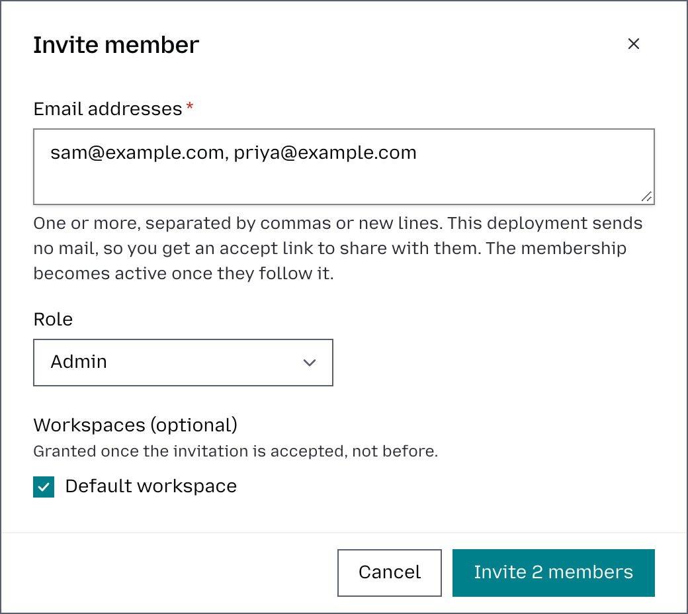

# Members and invitations

Organization **Admins and Owners** can invite other members to collaborate and control which workspaces they can access. This makes it easy to give each person access only to the areas relevant to their work.

## Invite a member

1. Go to **Organization** → **Members & roles**.
2. Click **Invite member**.
3. Enter one or more **Email addresses** separated by commas or new lines.
4. Select the **Role** you want to assign: Owner, Admin, Member, or Viewer.
5. Choose the workspaces the new member should have access to.
6. Click **Invite member**. The user will receive an invitation by email, and their membership will become active once they accept it. When no email goes out, the dialog shows an accept link to share with them instead, except where [Delivery](#invitations) says it does not.



You can paste up to 100 addresses at once. Everyone gets the same role and
workspaces. Each address succeeds or fails on its own, and the result shows, for
each one, whether its email went out or, where one is shown, the link to share.

## Manage existing members

Admins and Owners can also manage existing members. On **Members & roles**:

- the **Role** column changes a member's organization role;
- **Edit** changes which workspaces they can use and their role in each;
- **Remove** takes them out of the organization.

An invited row shows when its invitation has expired, and offers:

- **Reissue**, which sends a new accept link (or shows it, when no email goes
  out and links are shown). The old link stops working. Use this to recover a lost link, or instead
  of inviting the same address again, which is refused while an invitation is
  pending.
- **Revoke**, which withdraws the invitation.

Roles have predefined permissions. Owners and Admins can manage the organization, including its workspaces, provider keys, guardrails, pricing, and members, and have full access to usage data. Members and Viewers can access the workspaces they’ve been assigned to. See [Roles](workspaces.md#roles) for the full table.

## Let colleagues join by email domain

An owner or admin can claim an email domain, so colleagues with a verified
address there join without an invitation. See
[Email-domain auto-join](#email-domain-auto-join) for what this grants.

1. On **Email domains**, click **Claim domain**, enter the domain, and choose the
   role they join as: Member or Viewer.
2. Publish the record the page shows as a TXT record at the domain's apex:

   ```text
   otari-domain-verification=<token>
   ```

3. Click **Verify domain**. Once Otari finds the record, the domain starts
   admitting people.

Before the proof expires, verify the domain again from the same row to keep it
admitting people.

## How it works

### Invitations

**Delivery.** Where mail is set up, Otari emails the accept link. When the email does not go out (no mail, a failed send, or a mail limit), the dashboard shows the link to share by hand. A link that was emailed is never shown to the inviter. The email names the inviter by name and address. Where [signup is open](configuration.md#signup), only a deployment operator is shown a link: opening one accepts for the invitee, so anyone else's invitee signs in with that address and accepts from their pending invitations instead. When that invitee cannot sign in yet and the email did not go out, the inviter sends a new one with **Reissue** once mail can go out again. On a deployment with no mail and no Google or GitHub, an invitee who cannot sign in gets a password link from a deployment operator.

**Mail limits.** Over any 24 hours, an organization can send only so many
invitation emails, and an address can receive only so many from all organizations
together. An invitation over a limit is still created, and its link is shown to
share where links are shown at all, so a bulk invite never stops partway. Self-hosted deployments set the
limits under [Mail](configuration.md#invitations).

**Accepting.**

- Invitations waiting for you are listed under **Invitations**, reached from the
  organization switcher. Someone signed in who belongs to no organization is
  taken there when an invitation is waiting; otherwise Overview says how to get
  in. Creating an organization is offered only where signup is open.
- Opening an invitation link while signed in as a different address says who the
  invitation is for and offers to sign out, because accepting always adds the
  invited address.
- After you set a password from an invitation link, the sign-in screen opens
  with your address filled in.
- If the invited address has never signed in, the accept page asks for a first
  password, and they can sign in right away. No verification email is needed.
  Where the deployment publishes terms, they accept them here too.
- An address that can already sign in just accepts; the link cannot set or
  replace its password.
- If another organization has already added or invited the address, the link
  cannot set a password either, and the accept page says so. The person accepts,
  then signs in with Google or GitHub, uses "Forgot your password?", or asks the
  gateway's administrator, whichever the deployment offers.
- An invitee does not need the link. Signing up, or signing in with Google or
  GitHub, with the invited address completes the account, and pending invitations
  are listed under **Invitations** in the dashboard to accept or decline. Someone
  with no organization yet is taken there after signing in.

**Vouched addresses.** A password chosen through an invitation link counts as
verified for signing in, but Otari records that the organization vouched for the
address rather than that the person proved it. Until the person proves it, by a
Google or GitHub sign-in or a password reset by email, a vouched address does not
trigger [email-domain auto-join](#email-domain-auto-join), and other
organizations cannot add or invite it.

**When a link stops working.**

- A link works once, and expires after seven days unless a self-hosted deployment
  [changes that](configuration.md#invitations).
- A pending invitation closes when the person is added directly, removed, or
  accepts or declines from their dashboard.
- Revoking an invitation removes access only while it is still pending; someone
  who became a member another way keeps their access.
- An address whose account an operator deactivated cannot be invited or added,
  and its pending invitations stop working until it is reactivated.
- Refusals never reveal another organization's details.

Treat invitation links like passwords: whoever holds an unused link can join as
that address, and may choose its first password. Send it only to that person.

**Adding without an invitation.** The API can add a member directly
(`POST /api/v1/organizations/me/members`), active at once, with no email. A new
address added that way has no password and must sign up, reset its password, or
use Google or GitHub. Invite instead when you can, since the link sets the first
password. Where [signup is open](configuration.md#signup), anyone can create an
organization, so only a deployment operator can add members this way, and
everyone else invites. For the same reason, only an operator can set to active
someone who never accepted an invitation, such as one whose invitation was
revoked; anyone who once joined can be reactivated as usual.

**Which organization you act in.** After signing in, it is the one you last used,
or the oldest you still belong to if you were removed from it. Being removed,
declining, or having an invitation revoked moves you to the oldest organization
you still belong to. With none, the dashboard shows your invitations, and offers
to create an organization where signup is open.

### Email-domain auto-join

A claimed email domain lets people join without anyone deciding about each one,
so it is deliberately limited.

- **Only a proven claim admits anyone.** Several organizations may claim the same
  domain; the first to publish the record proves it. A claim on a domain somebody
  else owns therefore cannot lock out the real owner.
- **Only Member and Viewer** can be granted, never organization management.
- **Only verified addresses** join. An unverified address, or one only vouched
  for through an invitation link, is skipped.
- **Existing memberships are left alone.** A suspended membership is not revived,
  an existing role is not overwritten, and no workspace is granted, so somebody
  taken off a workspace on purpose is not put back by signing in.
- **The workspace named Default workspace is granted** to a new member, at the same role, so they have somewhere to work. An organization that has no workspace of that name grants none, and an owner or admin assigns one from **Members & roles**.
- **Joining does not change** the person's active organization.
- **Public email providers** cannot be claimed.
- **Other organizations cannot add, invite or reissue an invitation to** an
  address at a proven domain while its proof is current. Only a deployment
  operator can.

A proof expires after the deployment's set time, since domains change hands.
Otari does not re-check DNS between verifications, so until then a transferred
domain still admits people. Re-verify from **Email domains** to renew it.
