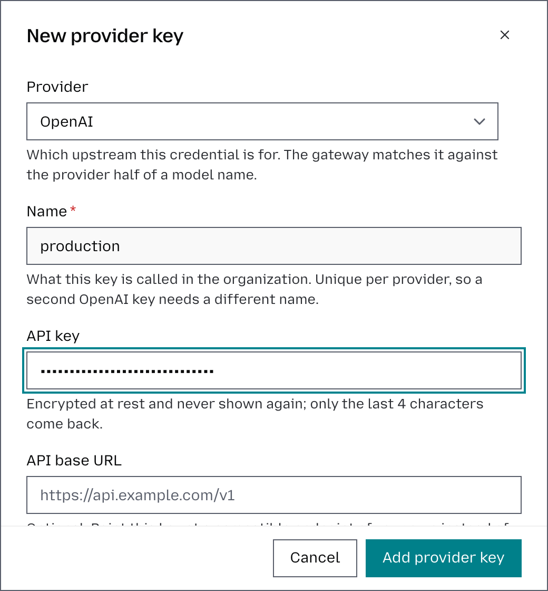
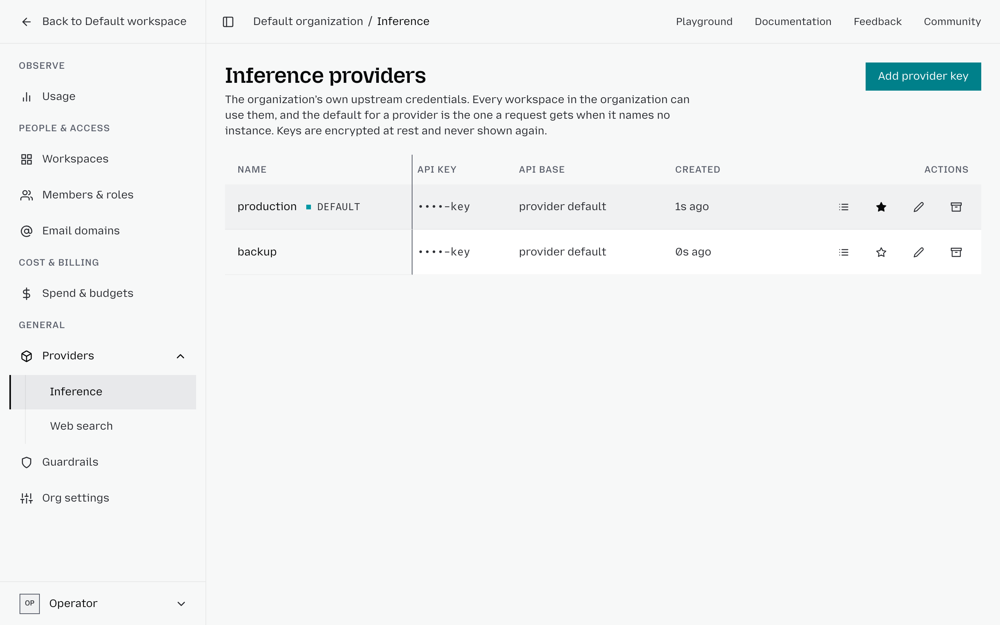
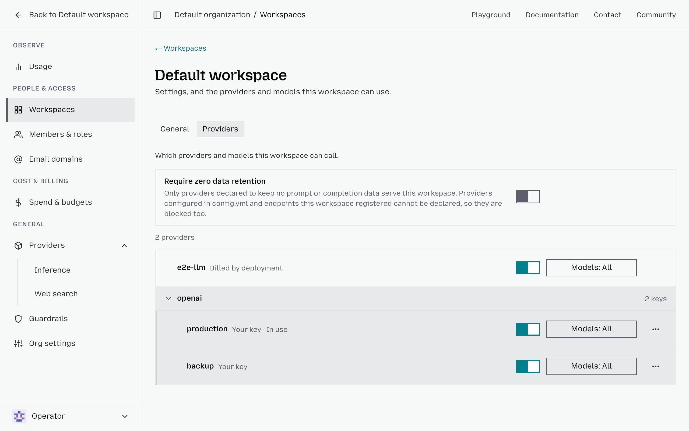

# Model providers

Otari calls LLM providers like OpenAI, Anthropic, or Mistral with the provider access your organization has. They live at the organization level. Workspaces inherit provider access by default and can pin or disable keys per provider.

## Two ways to get provider access

### Otari's hosted providers

These are Otari's pre-provisioned keys you can use without bringing your own key material. Otari handles the upstream credential, and requests on them are paid from your organization's [balance](billing.md). On otari.ai there is nothing to add: create an API key, as in the [Quickstart](quickstart.md), and your requests can use them. On a gateway you run, the operator sets them up first; see [Hosted providers and BYO credentials](hosted-providers.md).

### Your own keys

Bring your existing provider API keys and let Otari use them on your behalf. The upstream provider bills you directly, and Otari adds no per-token routing charge. When your organization has a key of its own for a provider, Otari uses it first.

Most organizations use a mix. Hosted providers are convenient for catalog models. Your own keys are for specific accounts, contracts, or providers not in the catalog.

## Add a provider key

1. From the main dashboard, click **Organization**.
2. Select **Providers**, then **Inference**.
3. Click **Add provider key** in the top-right corner.
4. Select the **Provider** from the dropdown.
5. Enter a **Name** to easily distinguish multiple keys for the same provider, such as `production`, `staging`, or `backup`.
6. Paste your **API key**.
7. For a compatible endpoint of your own, such as Synthetic or a vLLM server, enter its **API base URL**. Requests then reach this key's models by its **Request prefix**; see [Add a key for your own endpoint](#add-a-key-for-your-own-endpoint).
8. Click **Add provider key** to save it.

### Add a key for your own endpoint

A key can point at a compatible endpoint other than the provider's own, such as Synthetic or a vLLM server: enter its **API base URL** when you add the key. Requests then name the key by its **Request prefix** rather than by the provider, for example `synthetic:hf:Qwen/Qwen3.8-27B`.

The prefix is made from the key's name unless you enter one, and never changes once set, because your applications send it. To cap the key's spend, narrow a spend ceiling to its prefix, not to the provider. A key added without a base URL cannot gain one later: add a new key instead.

## Set a default key per provider

If you have multiple keys for the same provider, mark one as the default so workspaces inherit it automatically.

1. On **Inference**, find the keys for the provider.
2. Click **Make default provider** (the star icon) on the key you want workspaces to inherit.

Workspaces inherit the organization default per provider unless you define a different key.

## Keep a key's prices current

Each key's models are priced from the community prices of models.dev until you set your own rate. A model with no price is offered but not served, and stays off until it has one. Open a key's models on **Inference** to see them:

* **Refresh pricing** moves each default rate onto the models.dev prices in force, and turns on a model that now has a price. A rate you set yourself never moves.
* The line beside it says which models.dev catalog those prices come from, and its date.
* When the deployment has fetched newer prices that are not in force yet, the line says so. **Refresh pricing** cannot reach them: a deployment operator must update the catalog first. That update moves every key's default rates by itself, so no one has to press **Refresh pricing** afterwards.
* A default rate copied from another provider's listing of the same model shows that provider, for example **Default from cortecs**. models.dev had no price for the model under the key's own provider.

## How workspaces resolve provider keys

When a workspace makes a request, Otari resolves which provider key to use in this order:

1. If the workspace has a key pinned for the provider, use that.
2. Otherwise, use the organization default key for that provider.
3. If there is no default, or the workspace has turned it off, use another of the organization's keys for that provider that the workspace has not turned off.

This means a workspace inherits everything by default but can opt out of specific keys or override defaults per provider. When the organization has no key for the provider, Otari's hosted providers can serve the request; see [The credential ladder](hosted-providers.md#the-credential-ladder).

## Control workspace access

Once a provider key has been added at the organization level, open **Organization** → **Workspaces**, open the relevant workspace, and select its **Providers** tab to manage its provider access. It lists the keys and hosted providers the workspace can use. Click a provider to show its keys. For each key, you can:

* Leave it as it is to follow the organization.
* Turn its switch off to prevent the workspace from using that provider key.
* Select **Always use this key** from the key's **More** menu to ensure the workspace uses a specific provider key. Choose Stop always using this key in the same menu to follow the organization again.
* Use its Models control to restrict access to specific models from that provider.

A row you changed is marked Customized, and Reset in its menu returns it to the organization's settings.

**Require zero data retention**, at the top of the tab, limits the workspace to providers declared to keep no prompts or completions; see [Zero data retention](hosted-providers.md#zero-data-retention). Other providers are then refused, and the workspace's model lists show only declared ones.

## Rotate a provider key

Rotate a provider key by adding its replacement first. Keep the existing key active until requests succeed with the new credential. Provider keys are resolved at request time, so your application's API keys do not need changes during rotation.

Rotate a key when it has been compromised, or you suspect it has; when your organization has a periodic key rotation policy; or when you're migrating traffic to a new provider account.

1. Create a new API key in your provider's dashboard. Do not revoke the existing key yet.
2. In otari.ai, select **Organization**, then **Providers**, then **Inference**.
3. Click **Add provider key**. Select the same provider, enter a distinct **Name**, and paste the new API key.
4. Set the new key as the provider's default by clicking **Make default provider** (its star icon).
5. For each workspace that pins the old key, open it on **Workspaces**, select its **Providers** tab, and choose **Always use this key** from the new key's **More** menu.
6. Send a test request from each affected workspace. Confirm it completes successfully, and not on a fallback, in the workspace's **Overview**, on its **Requests** tab.

### Remove the old key

Once requests are flowing through the new key, revoke the old key in the upstream provider dashboard.

1. Return to **Organization** → **Providers** → **Inference** in Otari.
2. **Archive** the old provider key. An archived key can then be deleted.

Update every workspace that pins the old key before revoking it, and every workspace that has the new key switched off: switch it on or pin it there. A workspace can continue using a pinned key even after you change the organization default.

If you suspect compromise, create and assign the replacement immediately. Then revoke the exposed key with the provider.

### Rotate a key for your own endpoint

A key with its own [request prefix](#add-a-key-for-your-own-endpoint) is rotated in place, since no other key can take its prefix: edit the key on **Inference**, paste the new API key, and save.

## Provider keys vs API keys

These are two different things, and the naming is unfortunately close:

* **Provider keys** are your upstream credentials, like your OpenAI or Anthropic key, that Otari uses to call providers. They are managed at the organization level.
* **API keys** are the workspace-scoped tokens your application sends to otari.ai. They are managed per workspace.

Your application sends an API key to Otari. Otari uses a provider key to call the upstream provider. The application never sees the provider key.

## How security works

* **Organization scope**. Provider keys are owned by the organization, not copied into each workspace.
* **Workspace controls**. Each workspace decides which organization keys are effective for its workloads.
* **Role gating**. Only admins and owners can add or remove provider key material, or change which keys a workspace can access.
* **Runtime resolution**. Otari resolves the right provider key at request time. The workspace's API key never carries the upstream secret.

Removing a provider key from Otari does not revoke it with the upstream provider. After deleting a key from Otari, also revoke it in the provider's dashboard.
