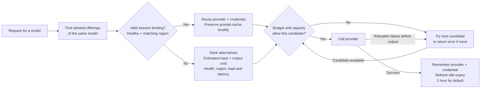

# Models

Otari routes provider calls through
[any-llm](https://github.com/mozilla-ai/any-llm). Provider support changes with
that dependency, so the running gateway's `GET /api/v1/models` response is more
reliable than a copied provider table.

## Model format

Use `provider:model`:

```text
openai:gpt-5
anthropic:claude-sonnet-4-6
ollama:llama3
```

The prefix selects a provider or named provider instance. Everything after the
first colon is sent as the provider's model ID.

A request may also name the model the way the catalog does. `vendor/model` (`deepseek/deepseek-v4.1-flash`) is the model's catalog id, and Otari picks the provider: among the priced offerings the caller can reach, the organization's own provider key where it offers the model, then the vendor's own provider where it serves the model, then the cheapest. `provider:vendor/model` (`nebius:deepseek/deepseek-v4.1-flash`) pins the provider and lets Otari pick the model id that provider spells it under. See [Catalog spellings](#catalog-spellings) for the rules.

The legacy `provider/model` spelling is still honored where it names an
offering the deployment serves (`openai/gpt-4o` while an `openai` instance
serves `gpt-4o`); read as a catalog id otherwise. Where it is also the catalog
id of a model the catalog also offers elsewhere (an OpenAI model served by
Azure OpenAI too, say), the named offering serves first and the others are
its fallback (see [Catalog spellings](#catalog-spellings)). Prefer the colon form in
configuration, pricing, aliases, and routing policies.

## Configuring a provider

Add a provider as a [hosted provider](hosted-providers.md), on the Hosted
providers page or through `/api/v1/hosted-providers`; it serves requests and its
models are discovered. The `providers:` block of `config.yml` is deprecated, and
a start copies what it can onto hosted providers (see
[Upgrading](hosted-providers.md#upgrading)); it remains the place for a provider
a hosted provider cannot hold, such as Bedrock on the server's own cloud role.
An entry there supplies its key from the environment with a `${VAR}` reference:

```yaml
providers:
  openai:
    api_key: ${OPENAI_API_KEY}
```

A key reaches a provider only from where a declaration names it:

- an entry's own `api_key` (a `${VAR}` reference included);
- a hosted provider's key;
- an organization's own provider key, which declares the provider for that
  organization's requests.

A provider's native variable (such as `OPENAI_API_KEY`) is never read
otherwise, so an entry with no `api_key`, or one carrying only `client_args`,
has no credential. A request it cannot serve is refused with a `424` and the
`provider_not_configured` code.

Keyless local backends (`ollama`, `llamacpp`, `llamafile`, `lmstudio`, `vllm`)
and providers authenticating from ambient cloud credentials (`bedrock`,
`sagemaker`, `vertexai`) need a declaration too, but no key: a bare entry
declares one. Undeclared, they are refused like any other provider.

```yaml
providers:
  ollama:
  bedrock:
```

The exception is a credential the deployment owns, one of its
[hosted providers](hosted-providers.md), asked only after every other source
missed; a build can rebind `ModelProviderPort` to decide differently. The order
of the sources is the [credential ladder](hosted-providers.md#the-credential-ladder).
The gateway logs a warning at startup
naming each `<PROVIDER>_API_KEY` variable that is set and that no entry's
`api_key` reads, and ignores an entry for a keyed provider that names no key.

Provider support is endpoint-specific. A provider that supports chat may not
support Responses, images, audio, rerank, or batches. Unsupported combinations
are rejected before dispatch when Otari can identify them.

## Named provider instances

Use a named instance when several backends share one provider implementation or
when a self-hosted server speaks a compatible protocol:

```yaml
providers:
  home_lab:
    provider_type: openai
    api_base: "https://models.example.com/v1"
    api_key: ${HOME_LAB_TOKEN}
    models:
      - qwen3-32b
```

Call this model as `home_lab:qwen3-32b`. Pricing and usage also use the instance
name. `provider_type: openai-compatible` and `openai_compatible` are accepted
aliases for the OpenAI implementation.

The optional `models` list supplies discovery for a backend that has no
model-listing endpoint. It does not restrict direct dispatch.

A workspace or a single user can also bring its own server, reached the same
way (`my-vllm:qwen3`) but visible only to its owner. See
[Provider endpoints](provider-endpoints.md).

## Local providers

Ollama, llama.cpp, and llamafile can run without an API key. Their entry
declares them, and `api_base` points at the server when it is not on the
provider's default address:

```yaml
providers:
  ollama:
    api_base: "http://gpu-box:11434"
```

Without an entry (or a hosted provider of the same name), a request for one is
refused as `provider_not_configured`, and its models are not listed. Otari does
not probe local servers merely because their provider exists in any-llm.

## Model discovery

`GET /api/v1/models` combines discoverable provider models, configured prices,
aliases, and routing-policy names, and lists each model once however many
providers serve it (see [Listing available models](#listing-available-models)). A provider's embedding and rerank models are
offered alongside its chat models. A provider that pages its listing, as Cohere
does, is read to the last page.
Together lists every model it can deploy, but serves most of them only on a
dedicated endpoint. Discovery leaves those out: it also asks Together for its
serverless models (`GET /v1/models?serverless=true`) and keeps only those. If
that listing fails, or is not shorter than the full listing, discovery keeps
every model. To serve a model on a dedicated endpoint of your own, add it to the
roster by hand.
Discovery is cached and bounded; an unreachable provider does not block the
catalog indefinitely.

A [hosted provider](hosted-providers.md) lists its roster, the models switched
on under it, rather than everything its upstream lists. How its listing is
dialed and refreshed, and what `serves_unlisted_models` changes, are in
[Catalog and discovery](hosted-providers.md#catalog-and-discovery) and
[Roster and serving](hosted-providers.md#roster-and-serving).

Each listed model carries the rate a request from the caller would be billed at,
and `pricing_source` says which price list it came from: `organization` for the
caller's organization's own override, `configured` for the deployment's stored
rate, `default` for the models.dev fallback, `dynamic` for a routing policy
that picks its model per request, and `none` for an unpriced model. An alias is
priced from its target.

Where that rate is a models.dev one nobody set, a completion whose provider
states what it charged is billed at that charge instead, which OpenRouter's
does; see [Keeping the defaults current](configuration.md#keeping-the-defaults-current).

An unknown price is reported differently per surface:

| Surface | Unknown rate (including an unset cache rate in `pricing`) | Source field |
| --- | --- | --- |
| `GET /api/v1/models`, `GET /api/v1/models/{model_id}` | Field left out | `pricing_source`, always sent; `none` when unpriced |
| An offering under `GET /api/v1/catalog/models/{model_id}` | `null` | `price_source`, `null` when unpriced |

The grouped listing summarizes an offering's price rather than carrying it. A
rate a pricing tier does not override is stored as absent, so neither surface
sends it.

Each model carries its token limits, `context_window` and `max_output_tokens`,
from models.dev's entry for the model under the provider serving it, unless an
override sets them (see [Overriding a model's details](#overriding-a-models-details)):

- A model a vLLM or SGLang server lists, through a configured instance, a
  hosted provider or an organization's own key, reports the context length
  that server runs it at (`max_model_len`, which a server built on vLLM lists
  under its own `owned_by` too), which beats models.dev's, and no `max_output_tokens`
  above it. Each listing of the server is stored, so the value survives a
  restart and reaches every worker within a minute. An organization's key is
  read only for that organization's callers, and is listed when the key is
  added or its models are refreshed. Where the provider has no models.dev entry for the model,
  the entry comes from models.dev's Hugging Face listing, under the model's own
  name or the model the server loaded.
- Until the gateway has fetched models.dev, and always with
  `models_dev_metadata: false`, the entry comes from the models.dev catalog
  bundled with the gateway.
- Where the entry has no context window, the bundled or accepted models.dev
  pricing snapshot supplies one. The snapshot keeps no output limit, so a model
  the catalog does not describe reports no `max_output_tokens`, nor any limit
  neither source knows.
- An alias reports its target's limits, and the grouped catalog reports the
  same values for each offering.
- An instance declared `openai-compatible` is looked up under OpenAI, so a
  model it serves under another name usually has no models.dev entry.

Each model also says what it accepts, in the fields OpenRouter's model listing
uses:

- `name`: models.dev's display name.
- `supported_parameters`: `tools` and `tool_choice` for a model that calls
  tools, `response_format` for one with structured output, and `reasoning` for
  a reasoning model. It names only the parameters models.dev records a flag
  for, not every parameter the model takes. `response_format` is left out where
  Otari cannot send it to the provider, as on Bedrock for every model but
  Anthropic's, or on MiniMax, Z.ai, Inception, SageMaker and llamafile for any
  model.
- `architecture`: `input_modalities` and `output_modalities`, such as
  `["text", "image"]`. models.dev gives an embedding model text output, as it
  does a chat model, so `architecture` alone does not tell them apart.

An SGLang server also says how it was started, and that overrides models.dev:
without a tool-call parser it offers no `tools`, a reasoning parser adds
`reasoning`, and what it reads besides text sets `input_modalities`. vLLM does
not say, so its models keep models.dev's flags, except that a listing entry
with a `reasoning` object (the efforts it accepts) adds `reasoning`.

All three are unset for a model neither models.dev nor its server describes,
which means unknown rather than unsupported. An alias reports its target's capabilities but
no `name`.

### Overriding a model's details

Where a provider's server and models.dev say nothing about a model, or say it
wrong, whoever holds the key that serves it can set its details on the model's
page in the dashboard: **Edit details** on its row of offerings. The deployment
operator sets them for the deployment's own providers, and an organization's
owners and admins for the models its own provider keys serve, which only that
organization's callers see.

An override sets any of the context window, the maximum output tokens, whether
the model calls tools, reasons or takes `response_format`, and what it reads.
Each field it sets wins over the server and models.dev; a field it leaves blank
keeps their word, and saving every field blank removes the override. It cannot
add `response_format` where Otari cannot send it to the provider. An override
changes what the listing says and nothing about how a request is served.

Deleting a hosted provider deletes the details set for it. An organization's go
when it deletes its last key under that prefix; archiving a key keeps them, so
restoring it brings them back.

`type` says what kind of model it is: `chat`, `embedding`, `image`, `speech`,
`transcription`, `rerank`, `moderation`, `video`, `decision`, `realtime`, or
`other` (not a chat model, nothing more known; OVHcloud's listing says this of a
model that writes no completion tokens).

- It comes from the provider's own model listing where that says (Together's
  `type`, DeepInfra's tags, DeepSeek's `output_modalities`, OVHcloud's
  `max_completion_tokens`), otherwise from the `type` in models.dev's v2
  catalog, and is unset where neither does. The v1 catalog gives no type.
- models.dev's `reranking` maps to `rerank`, its `audio` to `speech`, and a
  value it adds later is `other` until the gateway knows it.
- A chat request whose every candidate is an embedding, rerank, transcription
  or `other` model is refused with `400` `wrong_model_type` before any provider
  is called, as is an embeddings request for a model its provider lists as
  another kind. A `decision` or `realtime` model is not refused, because some
  hosts serve one through chat completions.

The models.dev catalog is refreshed as follows:

- One worker downloads it every `models_dev_cache_ttl_seconds` (a day by
  default) and stores it in the database; every worker serves the stored copy
  within 30 seconds. A model listing never waits on the download, and after a
  restart the stored copy is served at once.
- The stored catalog records the `models_dev_base_url` it came from. After a
  restart with another one, it is served until a download from the new source
  replaces it, which is tried within a minute rather than after the interval.
- A catalog update, **Update catalog** on the Hosted providers page or
  `POST /api/v1/hosted-providers/catalog-update/preview`, stores the catalog
  it downloads for the prices at once when `models_dev_metadata` is on, so a
  new model's kind and details arrive with its price. A database error there
  is logged and does not fail the update.
- A failed download is tried again a minute later. The gateway reads
  models.dev's v2 catalog (still experimental at models.dev), and its v1
  catalog when v2 cannot be fetched or read, logging one warning when it falls
  back. Both give the same limits, capabilities and prices.
- Both are read from `models_dev_base_url`, by default Mozilla.ai's fork of
  models.dev, which serves models.dev's catalog plus the models it does not
  list yet. See [Configuration](configuration.md#keeping-the-defaults-current).
- When neither can be read, the last good copy stays in use and the gateway
  logs why.
- A document is refused when it lists no models or when more than a quarter of
  its models are damaged. A few damaged models are left out, and one warning
  names them.

Set `model_discovery: false` to publish a curated catalog made from aliases and
explicitly priced models. For a backend with no listing API, use the instance's
`models` list.

### Who is shown which models

An API key is shown the models its allow-list permits, so the catalog never
advertises a model that would be refused at inference. A dashboard session is
answered from its membership:

- A caller who operates the deployment sees the whole catalog.
- Anyone else sees every `providers:` instance (deployment-wide), plus the
  models their own organization's provider keys reach, plus the models a hosted
  provider serves where no workspace key of theirs supplies that provider,
  narrowed by any workspace model restriction.

The models an organization's own key reaches are the ones offered on it, as the
Providers page records when it pulls a key's catalog. Each carries a Serving
switch; a model switched off leaves the catalog and is refused at dispatch. A
key nobody has refreshed has no rows at all, which means it is unnarrowed and
reaches whatever its provider serves. A key with every model switched off
serves nothing.

The Providers page lists a key's models one kind at a time: tabs above the
table name each kind the key offers (Text, Image, Video, Embeddings and so on)
with how many models it has, and **All** shows every kind. The kind comes from
models.dev, and a model it does not know is under **Unknown**. The columns are
the same on every tab. A token price is per million tokens. A price in another
unit is shown under the side it bills, so an image price, or a video model's
per-second price, is under **Output**, and hovering it names what it prices and
its unit ("Video output, $0.045/second"). A per-second price on any other kind
of model is audio, shown on the side it is stored on. On a phone, which cannot
hover, the unit is shown beside the amount. The search box beside the tabs
keeps the models whose name contains what is typed, in any case, and the
**Serving** / **Not serving** choice beside it keeps the models switched on or
off; the tab counts then count only those. The list endpoint,
`GET /api/v1/organizations/me/provider-keys/{key_id}/models`, takes the same
kind as `type` (`unknown` included), the search as `search` and the switch as
`enabled` (`true` or `false`), returns each model's `type`, and counts every
kind the search and the switch keep in `type_counts` whichever one it returns.
The hosted providers' `GET /api/v1/hosted-providers/{provider}/models` takes
the same three.

A model nothing prices is offered switched off while `require_pricing` is on,
and the switch refuses to turn it on until it has a rate, so a model the
pricing data has not caught up with cannot be billed at nothing. With
`require_pricing: false` the deployment serves unpriced traffic by choice, so
such a model is offered switched on and served at no cost, like an unpriced
model of a `providers:` instance (see
[Default pricing](configuration.md#default-pricing)).

A refusal on that path says which narrowing turned the model away (see
[Error codes](api-reference.md#error-codes)):

| Situation | Response |
| --- | --- |
| The key offers the model with its switch off | `403 model_not_serving`, naming the key and pointing at the switch |
| No key of the provider offers the model | `404 model_not_found` |
| An undated name whose dated builds are all switched off | `403 model_not_serving` |
| An undated name with more than one dated build to choose from | `404 model_not_found`, naming them (see [Catalog spellings](#catalog-spellings)) |
| The key serves the model but a workspace restriction or the API key's allow-list excludes it | `403 model_not_allowed` |

The Providers page shows each key's serving count beside it.

Aliases and stored routing policies are workspace-scoped rows. A session is
shown them only where the workspace it comes from is one the caller may see
(on a single-tenant deployment, everyone in it). An API key sees its own
workspace's.

## Capabilities

`model_capabilities` can correct image and PDF support when a compatible
provider reports capability at the protocol level rather than for each model:

```yaml
model_capabilities:
  "ollama:qwen2-vl":
    supports_image: true
    supports_pdf: false
```

File handling uses these values to decide whether to pass an attachment through
or normalize it for a text-only model. See [Files](files.md).

## Prompt caching

Mark the prompt prefix to cache the way Anthropic does, with `cache_control`
(`{"type": "ephemeral"}`, optionally `"ttl": "1h"`): on a system block or content
block on `/api/v1/messages`, or on a message or content part on
`/api/v1/chat/completions`. Anthropic models read it natively. For Gemini, any-llm
turns the last breakpoint into a Gemini context cache holding everything up to
it, reuses that cache while it lives (5 minutes, or 1 hour with `"ttl": "1h"`),
and falls back to an uncached request when Gemini refuses a prefix below its
minimum size. Gemini 2.5 and later models also cache repeated prefixes on their
own, with nothing marked.

Either way, the usage reports the tokens written to and read from the cache, and
Otari bills them at the model's `cache_write_price_per_million` and
`cache_read_price_per_million` when the pricing sets them, and at the input price
otherwise. On either route, a Claude model whose cache writes are priced bills a
1-hour write at twice its input price, as Anthropic does, on a `cache_write_1h`
charge line. The time a Gemini cache is stored is not billed separately.

## Model aliases

An alias gives callers a stable name for one real selector:

```yaml
aliases:
  fast: openai:gpt-5-mini
  local: home_lab:qwen3-32b
```

Callers send the alias in `model`. Completion responses keep the alias while
pricing, budgets, and usage use the resolved target, which the gateway
names in the `Otari-Provider` and `Otari-Model` response headers. Configure the
target's price, not a price under the alias.

An alias also withholds its target offering from `GET /api/v1/models` in that
workspace, where the alias is listed in its place; the model stays listed while
another provider serves it. This does not apply to routing-policy
targets. The grouped catalog (`GET /api/v1/catalog/models` and the Models page)
lists real models only and never an alias, so an aliased model stays in it.

Aliases are useful for a curated catalog. A routing policy is the broader form
when a name needs conditions, failover, weighting, or mandatory guardrails. See [Routing](routing.md).

Alias names cannot contain `:` or `/`, collide with provider instances, or
point to another alias.

### Runtime aliases

Operators can manage aliases from Routing or `/api/v1/aliases` without
restarting. A stored alias belongs to a workspace and can optionally be narrowed
to one user. Resolution prefers the most specific applicable alias.

The authenticating API key determines the workspace. A user-scoped alias applies
to all of that user's keys in the workspace. Config-file aliases are
deployment-wide and apply in every workspace.

Use the generated OpenAPI specification for management request shapes and
scoping parameters.

## Routing-policy model names

A static one-target policy resolves anywhere an alias does. A conditional,
weighted, or priority policy applies only to Chat Completions, Messages, and
Responses because other endpoints do not provide the request context needed to
choose a candidate.

Policies appear as model names, but dynamic policies have no single price.
Price their concrete candidates. Unlike aliases, policies do not hide candidate
models from the catalog.

## The catalog, grouped by model

`GET /api/v1/catalog/models` reads the same merged catalog as `GET /api/v1/models` and
folds it by model the same way, so `nebius:zai-org/GLM-5.3` and
`fireworks:accounts/fireworks/models/glm-5p3` are two offerings of one entry.
`?at_context=<tokens>` on the list takes each model's minimum from the pricing
tier a request of that size would settle at, so tiered offerings compare at
the size that matters rather than at their base rate.
A model's minimum compares only prices in one unit. `price_unit` names it
(`token`, `image`, `second`, and so on), and the minimum is per million of it.
Where one offering bills per token and another per image, no number compares
the two, so `price_unit` and both minimums are null; the model's offerings
still carry their own prices.
`GET /api/v1/catalog/models/{id}` lists every offering of one model the caller may
use, cheapest first, with each provider's context and output limits and the
price the caller's organization would be charged, labeled by which price list
it came from: the organization's own override, the deployment's stored rate, or
the models.dev default. Both routes accept the same credentials as
`GET /api/v1/models`, and a model the caller may not use answers 404.

Grouping keys on the models.dev display name where the dataset knows the
model, and on the provider's id with its path prefixes, org segment and version
pins removed where it does not; a vendor's name written in front of its own
model (`NVIDIA Nemotron 3 Ultra`, `openai-gpt-oss-120b`) is dropped from both.
Bedrock's cross-region inference profiles of one model, such as `us.moonshotai.kimi-k3` and `global.moonshotai.kimi-k3`, are offerings of that one model: the profile prefix is dropped from the id, and the region models.dev puts in the profile's name, as in `Kimi K3 (US)`, is dropped from the name. A
model's id is its vendor and its name, `z-ai/glm-5.3`, or the bare name where
nobody could say the vendor. The vendor is the org of models.dev's
`canonical_model_id` where the dataset has one, else the org segment of the
provider's id, else the model family (`claude`, `nemotron`). A dated build, a size or tier, and a mode a
reseller exposes as its own id stay separate models. models.dev's description,
capabilities and modalities are served to every catalog reader here, where
`GET /api/v1/models/metadata` stays operator-only.

An offering's `pricing` gives the per-million rates and their `unit`, and
`pricing.rates` gives the whole price as a models.dev cost block: each
modality's input and output price in its own unit, the web search price, and
the overrides and multipliers that change a price when a condition holds (see
[Overrides and multipliers](configuration.md#overrides-and-multipliers)).
`GET /api/v1/models` carries the same field.

Each offering also carries the provider's list price from the live models.dev
catalog, where it has one. The default is billed from the accepted models.dev
snapshot, which can lag that catalog, so a difference between the two means a
price update is waiting for review. Each offering also carries, for a signed-in
caller, the organization's last thirty days on that offering: requests, cache
hit rate, and the effective price per million tokens after cache reads and
tiers.

Each offering also lists the Otari routes its models.dev protocols map to, in
`endpoints`. A route is a path below the API base, so `/embeddings` is called at
`/api/v1/embeddings`. The list comes from the protocols in models.dev's v2
`api` block for that offering, in models.dev's order:

| models.dev protocol | Route |
|---|---|
| `chat-completions` | `/chat/completions` |
| `responses` | `/responses` |
| `messages` | `/messages` |
| `images` | `/images/generations`, `/images/edits` |
| `embeddings` | `/embeddings` |
| `speech` | `/audio/speech` |
| `transcriptions` | `/audio/transcriptions` |
| `rerank` | `/rerank` |
| `moderations` | `/moderations` |
| `videos` | `/videos` |
| `decisions` | `/decisions` |
| `systemone` | `/systemone` |

models.dev does not say which image models can edit, so every offering with
the `images` protocol lists both image routes. An edit to a model that only
generates, such as `dall-e-3`, is refused by the provider.

`/decisions` and `/systemone` take only a selector whose provider is a
`decision_providers` entry. An offering from another provider instance lists
them when its models.dev entry names those protocols, but a request to either
route with that offering's selector is refused.

Other protocols name no route. A vendor's native protocol, such as `converse`
or `generate-content`, is what any-llm calls behind the routes above, so a
client never calls it directly. A live, two-way session (`realtime`, `live`),
`fim` and `ocr` have no Otari route. An empty list means not known:
models.dev has no entry for the offering, its download is v1, which has no
`api` block, or none of its protocols has a route. Otari does not guess routes
from the model's `type`. The list repeats what models.dev says, so a model it
gives the wrong protocol shows the wrong route until models.dev is corrected.

The dashboard's "Use this model" drawer reads this list. It shows the request
for the route of the offering that answers, and offers a choice where the list
has more than one ([Browsing the grouped catalog](#browsing-the-grouped-catalog)).

### Browsing the grouped catalog

**Models** shows one card per model, with filters beside the list. A model's page
compares every offering in a table, with each offering's limits and the price
your organization pays.

- Prices are shown in the unit they bill, such as "$0.50 / 1M" for tokens or
  "$0.04 per image". A card shows the cheapest price when all offerings bill in
  one unit, and "priced in several units" otherwise.
- **Price rules** under the table lists each offering's overrides and multipliers
  in words, such as "×0.5 on every price when service tier is flex". They are
  read-only here; see [Overrides and multipliers](configuration.md#overrides-and-multipliers).
- Each row shows the provider's own model ID, which tells apart offerings on one
  provider, such as Bedrock's regional inference profiles.
- **Use this model** opens a drawer with a request to copy, for the route the
  offering is served on.

The page is read-only. An organization sets its own rate on **Providers >
Inference**, which an offering on one of its keys links to.

The Models page requests one page at a time from `GET /api/v1/catalog/models`.
Filters and sorting apply to the caller's full authorized catalog before `skip`
and `limit` select a page. `count` is the number of matching models before paging;
`limit` defaults to 100 and is capped at 1,000.

Repeat `provider`, `vendor` or `type` to match any selected value. An empty `vendor`
selects models whose vendor is unknown, and `type` never matches a model of
unknown kind. A model's `type` is the kind most of its offerings give (see
`type` above); a tie goes to the vendor's own provider. The Models page's
**Model kind** filter sets `type`, from the kinds in `facets.types`, and each
model on the page names its kind. Repeat `input_modality`,
`output_modality`, or `capability` to require every selected value. The endpoint
also accepts `search`, `min_context`, `max_input`, `pricing`, `source`,
`zero_data_retention`, and `released_within_days`. Release windows end today in
UTC and exclude unknown and future dates. `max_input` is a price per million
tokens, so it excludes models with no known input rate and models priced in
another unit. `pricing=priced` keeps every model with a priced offering,
whatever its unit. `zero_data_retention=true` keeps the models at least one
offering declared zero data retention serves.

Each offering carries `zero_data_retention`, and each model lists the providers
whose offering of it is declared in `zero_data_retention_providers`. A
declaration is the operator's or the organization's statement about the
provider account, which Otari does not check; whose declaration applies is in
[Zero data retention](hosted-providers.md#zero-data-retention). The Models
page marks these models and their offerings, and its **Data retention** filter
sets the parameter.

`sort` accepts `name`, `released`, `input`, `output`, `context`, or `providers`,
with `direction=asc` or `desc`. Unknown values sort last in either direction;
names and catalog ids break ties so pages have a stable order. A price sort
compares a price only with prices in its unit: models priced per token come
first, then each other unit's models in turn.

Request `include_facets=true` to receive the provider, vendor and type choices from
the complete authorized catalog, whatever the filters match, so a filter that
matches nothing can still be undone. `facets.total_count` counts authorized
models before filtering. `facets` is null unless requested, and never names a
model or provider the caller cannot access.

### Catalog spellings

A provider's own id can be long, so the gateway also accepts the two spellings
the catalog shows. Each is relabeled like an alias, so a response's `model` is
what was sent, and pricing, budgets and usage key on the offering reached.

- The model's catalog id (`z-ai/glm-5.3`, `deepseek/deepseek-v4.1-flash`). Discovery uses this baseline order, and automatic routing uses it as a tie-breaker:
  1. Priced offerings before unpriced ones (an unpriced offering costs nothing and so escapes budgets).
  2. Among the priced ones, the organization's own provider key, even where another offering is cheaper.
  3. The vendor's own provider, where the id's vendor is also a provider (`openai/gpt-4o`).
  4. The other offerings, cheapest first at the caller's rates, ties in A-Z order.

  To make an unpriced offering lead (an organization's own key or a local model, say), give it a price, even 0.
- `instance:<catalog id>` (`nebius:deepseek/deepseek-v4.1-flash`) pins the instance and resolves to the model's first offering there by the same order, never elsewhere. This is the spelling the catalog shows as an offering's `short_selector`.
- On an organization's own provider key, a provider's undated name (`anthropic:claude-haiku-4-5`) resolves to the dated build the key serves under it (`claude-haiku-4-5-20251001`), where exactly one serving model is that name plus a release date (`-YYYYMMDD` or `-YYYY-MM-DD`). The dated build's serving switch, price and allow-lists apply as if it had been sent. A name with two dated builds, at least one of them serving, is refused as not found (404 `model_not_found`), and the detail names both; a name whose dated builds are all switched off is refused as not serving (403 `model_not_serving`). Neither detail names the dated builds to a caller who reached the model through an alias. A selector whose prefix names a `providers:` instance is never rewritten this way, even for a caller whose organization also holds a key for that provider: the instance sends any id to the provider as written.

A selector that already names an offering is never rewritten, so a provider's
own id keeps working verbatim.

The index behind this is rebuilt every minute and on
`POST /api/v1/catalog/selectors/refresh`, an operator call. It holds the
deployment's catalog view, priced from the deployment's list and the defaults,
and one view per organization for the models it offers on its own provider
keys, priced at that organization's rates. An organization's view answers only
its own callers: a model one tenant reaches through its key is never where
another tenant's selector lands, and a model nobody offers to the caller
resolves as the deployment's view says. A model's `selector` in the catalog is
null where the caller has no such spelling for it.

A request that names a catalog id with more than one offering falls back across
them:

- Automatic routing ranks eligible offerings for each request (see below). When
  the selected offering fails before it sends a response, the next one serves
  the request, as a routing policy's `on_failure` list does.
- A catalog id spelled like the legacy `provider/model` of one of its own
  offerings (`openai/gpt-4o` while the `openai` instance serves `gpt-4o`) tries
  that offering first and the others after it in the usual order.
- The colon spelling of an offering (`openai:gpt-4o`) never falls back, so it is
  the way to pin one provider.
- The offerings a key may not use are left out first, so a key whose allow-list
  names one offering reaches it by the catalog id.
- A plan tries at most five offerings.
- Usage rows record the catalog id as `policy_name`, `catalog` as the first
  offering's `selection_reason`, and `on_failure` for the ones after it.

### Automatic provider selection

Chat, Messages and Responses requests sent to an unpinned catalog ID
use automatic selection by default. It compares up to 32 eligible offerings of
the **same model**, keeps the best five, and retries in that order. Explicit
policies, aliases, `instance:model` pins and legacy `provider/model` spellings
that name an offering keep their existing behavior.



Send the same `Otari-Conversation-Id` on each turn. Without it, every request is
ranked independently. Region remains a preference, so fallback can cross regions.

Selection uses these signals:

- **Health:** recent upstream 429s, 5xx responses, connection failures and timeouts
  put an offering behind healthy alternatives for 15 seconds. It stays available
  as a last resort. Client cancellation and gateway refusals do not count as outages.
- **Estimated cost:** known prices come before unknown prices. The estimate
  includes input and output tokens, applicable long-context tiers, and cache-write
  pricing where requested. It uses the caller's organization prices, then the
  deployment list, then enabled defaults. Missing prices are never treated as free.
  Token counts are estimates; output uses the request's limit or the configured
  default. Tool calls and other work whose quantity is not yet known are not predicted.
- **Own provider key:** among healthy, priced offerings, the organization's own
  provider keys come before offerings the deployment pays for, even where those
  are cheaper, faster or closer. The other signals order the offerings within each
  group. An own key that is cooling down after an outage, or has no known price,
  yields to the deployment's offerings until it recovers.
- **Region:** among healthy, priced offerings, prefer the caller's region when
  the operator has declared the endpoint's location. A caller can send
  `Otari-Region: us` or `Otari-Region: eu`. Otherwise, an explicitly trusted edge
  country header maps US to US and EU member countries to EU. Other or unknown
  countries use the configured default, which is unset initially. This is a
  preference with cross-region fallback, **not a residency guarantee**.
- **Load and latency:** active calls to the same credential and model count
  against its configured relative capacity. Recent successful calls supply an
  exponentially weighted latency estimate: time to first output for streams,
  completion time otherwise, kept separately by API and response mode. Unknown
  latency is neutral; measurements expire after five minutes.
- **Sticky sessions:** send the same `Otari-Conversation-Id` on every turn. After
  a successful response, that conversation keeps its provider and credential,
  even if another offering becomes cheaper or faster. The binding is reused only
  while the provider is healthy, matches the current region preference, remains
  allowed, and passes budget and rate-limit admission (including concurrency).
  An unhealthy or refused bound provider loses its binding; a successful fallback
  becomes the new binding. Cancellation does not invalidate or refresh it.
  Sessions expire after one hour without a successful response by default,
  configurable with `automatic_routing.session_ttl_seconds`. Without a conversation
  ID, each request is ranked independently; matching prompt text is not a session.
  Stickiness does not require cache pricing. It improves the chance of reusing a
  provider prompt cache but neither enables caching nor guarantees a hit, and
  never discounts the budget reservation.

For a new session or an unusable binding, known prices precede unknown ones,
including during an outage. Within each pricing-availability, health, own-key and
region group, the score is estimated cost divided by the cheapest known cost in that
group (with a $0.000001 floor), plus 0.5 times active calls divided by capacity,
plus 0.25 times relative latency (capped at 3). Lower wins; ties keep the baseline
order. A binding to an unpriced offering is discarded when a priced alternative
is available, and a binding to an offering the deployment pays for is discarded
when a healthy, priced own key is available. Prices are batch-read and reused for admission and settlement.
An offering whose initial budget reservation is refused is skipped, and the next
is checked at its full price. Every budget still has to admit the serving provider;
if none fits, the request is refused without an upstream call.

State and scope:

- Feedback is local to each gateway worker, bounded to 10,000 health entries and
  10,000 conversation digests, and reset on restart. It measures traffic through
  that worker, not a provider's global utilization. Existing rate-limit
  admission still enforces capacity, including shared Redis limits.
- Session affinity is scoped to the authenticated workspace, user, key and API;
  credentials are also part of the provider identity. Credential rotation
  starts a new history; Bedrock client recreation and Vertex service-account
  token refresh preserve it.
- No affinity is kept for a credential supplied only at dispatch by a
  deployment extension, an opaque custom credential object, or a
  service-account signer without a key ID.
- Only keyed digests and numeric observations are retained, not prompt text or
  credentials.

Configure endpoint regions, relative capacity and the trusted location header in
[`automatic_routing`](configuration.md#automatic-routing). Set `enabled: false`
to restore baseline selection.

The dashboard's Models page and the Routing page's Automatic fallback section
show this catalog and this order; see [Automatic fallback](create-a-multi-provider-routing.md#automatic-fallback).

With `public_catalog: true` (see [Configuration](configuration.md)), the same
two routes and the same page are served to a visitor with no session, at the
deployment's rates and for the models the deployment itself serves, its
hosted providers included. A visitor's
"Use this model" opens account creation instead of the drawer (sign-in where
signup is closed), and the dashboard reopens that model on their first sign-in.

## Listing available models

```bash
curl http://localhost:8000/api/v1/models \
  -H "Authorization: Bearer $OTARI_API_KEY"
```

The listing has one entry per model, and its `id` is the model's catalog id
(`z-ai/glm-5.3`, `openai/gpt-4o`), not a `provider:model` selector. Send that id
as `model` and Otari chooses the provider: it tries the model's offerings best
first (priced before unpriced, then your organization's own key, then the
model's own vendor, then the cheapest) and falls back to the next when one
fails. A catalog id spelled like the legacy `provider/model` of one of its own
offerings (`openai/gpt-4o` while the `openai` instance serves `gpt-4o`) tries that
offering first (see [Catalog spellings](#catalog-spellings)). An entry's price, limits, capabilities and `deployment_managed` are those
of the offering tried first, and `owned_by` is the model's vendor.

To pin a request to one provider, send its `provider:model` selector, which
still works everywhere it did. `?provider=<instance>` lists only the models that
instance serves, described as it serves them, and
`GET /api/v1/catalog/models/{id}` lists every offering of one model.
`GET /api/v1/models/{id}` answers for a catalog id, an alias, or a selector.

On a deployment that hosts at least one provider, an organization API key is
shown a priced model only where something would
serve it from the key's workspace: a configured instance, the organization's own
provider key, or a hosted provider the deployment serves the organization. A hosted provider the operator switched
off or deleted leaves its rates on the price list, and its models leave this
listing. The master key and an operator session still list the whole price
list.

## HuggingFace provider routing

A HuggingFace model may be served by several inference providers. Pin the backend
when deterministic routing and pricing matter:

```text
huggingface:zai-org/GLM-4.6:together
huggingface:zai-org/GLM-4.6:novita
```

Otari splits only the first colon, so the backend suffix reaches HuggingFace
unchanged. Auto, cheapest, or fastest routing cannot be assigned one reliable
backend price; configure pinned selectors when enforcing budgets.
