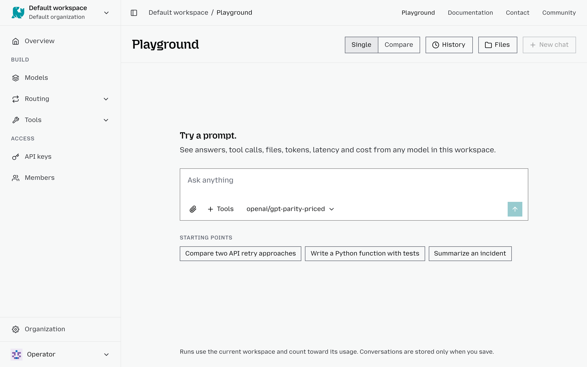

# Playground

The Playground lets you test different AI models directly in Otari, experiment with prompts, and compare responses. You can evaluate model performance, including response quality, token usage, latency, and cost, to help you choose the best model for your needs.

## Test a single model

1. From your workspace, click **Playground** in the top navigation menu.
2. Make sure **Single** is selected.
3. Choose a model from the dropdown menu below the prompt box.
4. Enter your prompt or select one of the suggested **Starting points**.
5. Optionally, click **Tools** to add tools to your request, such as web search, code execution, or MCP servers, and attach files with the paperclip. Only the MCP servers your [access rules](add-an-mcp-server.md#control-who-can-use-it) let you reach are listed.
6. Press Enter or click the Send button to submit your prompt.
7. Review the model's response and available usage and performance information.

## Compare two models

Use Compare mode to evaluate how two different models respond to the same prompt.

1. Click **Compare** at the top of the Playground.
2. Select Model A and Model B using the dropdown menus.
3. Enter your prompt in the text box at the bottom.
4. Optionally, click **Tools** to include tools in your request.
5. Submit your prompt to see both models' responses side by side.
6. Compare their answers and available performance metrics to determine which model best suits your needs.

## View your history

You can revisit previous conversations and model comparisons through the Playground's History feature.

1. Click **History** in the top-right corner.
2. Filter your history by All, Chats, or Comparisons.
3. Use the **Search history** field to find a specific conversation or comparison.
4. Select a saved entry to revisit it, or click View all to access your complete history.

Your saved Playground history is private and visible only to you.

## What a Playground request is

Requests run through the same path as any completion, so routing policies,
guardrails, budgets and tools all apply, and every request appears on the
Overview.

**Billing.** A Playground request uses no API key. It is billed to you, in the
workspace selected in the switcher, against your own budget and rate limit, and
its usage row has no key. A viewer cannot send one. Playground requests do not
complete the [setup guide](quickstart.md#the-setup-guide).

**Files.** Attach files with the paperclip or by dropping them on the page. The
model reads them like an API request's [uploaded files](files.md); in Compare,
both models get them. Removing a file from a question keeps the upload, and the
**Files** dialog lists your uploads in the workspace to reattach or delete. These
controls are hidden when file uploads are off.

**Tools.** Each tool call shows above the reply as a collapsed row with its
status, its arguments and what it returned. This is shown only in the Playground
and is not saved; an API request still gets only the final message (see
[What clients receive](tools.md#what-clients-receive)).

**What is stored.** Each request is recorded in usage, as any request is. Its
content is kept only once you save a conversation or record a comparison. The
first time, you are asked to agree to content retention; you can withdraw that
later, which blocks new saves and deletes nothing. Saved conversations,
comparisons and pinned models are visible only to you, and each can be deleted.
