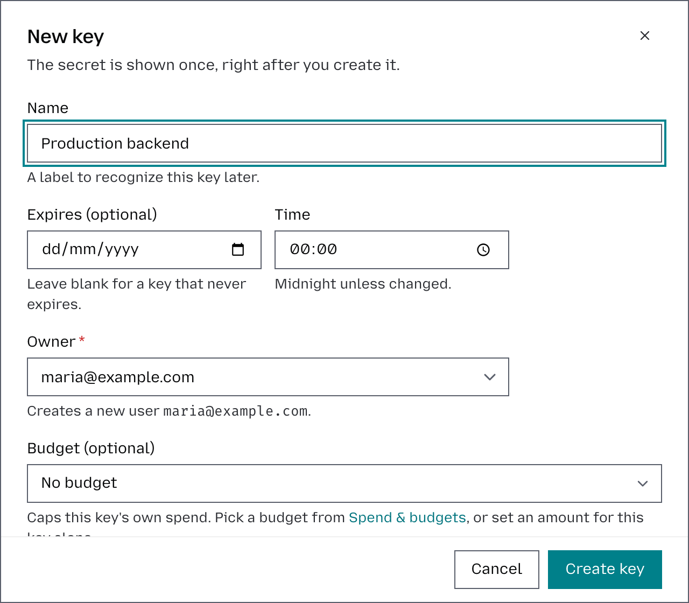
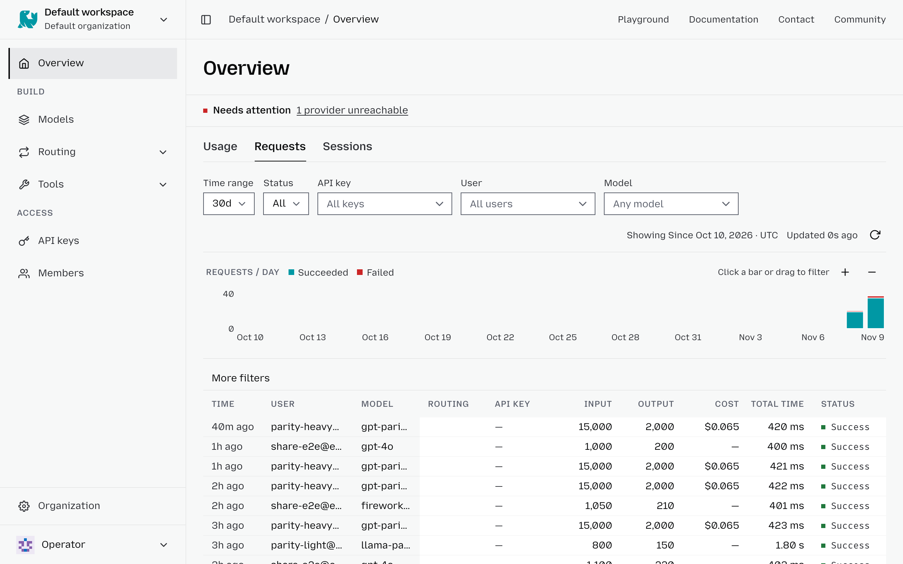

# Quickstart

This quickstart gets you to your first LLM request as fast as possible. You'll use your default workspace, generate a workspace token, choose a model, send one request, and confirm it appears on the workspace's Overview.

**Estimated time: 5 minutes.** All you need is an otari.ai account with some [balance](billing.md) or your own [provider key](manage-provider-keys.md).

To run Otari on your own machine instead, follow the [Self-hosted quickstart](self-hosted-quickstart.md).

## 1. Open a workspace

Use your default workspace for the first request.

1. Log in to [otari.ai](https://otari.ai).
2. Open your default workspace in the top-left corner.
3. You will use the **API keys**, Models, and **Overview** pages in this guide.

## 2. Generate an API token

Generate the credential your app will actually send to otari.ai. This token starts with `otk_`.

1. Open the **API keys** page.
2. Click **Create key**.
3. Give the key a name and, if needed, set an expiration date. By default, the key inherits your existing model access, but you can limit it to specific models. To customize model access, click **Advanced** and select the models you want the key to use.
4. Click **Create key**, then copy the token right away. It is only shown once.



**Keep it secret**. Treat the token like a password. Keep it in your shell or secret store, not in source control:

```bash
export OTARI_API_KEY=otk_...
```

## 3. Send your first request

Pick a model your workspace can use.

1. Open the Models page.
2. Choose a model using the available filters, including modality, provider, vendor, capabilities, and more, to quickly find the option that best fits your needs.
3. After selecting a model, click **Use this model**, and copy the model selector from the panel that opens.

otari.ai exposes an OpenAI-compatible endpoint at `https://api.otari.ai/api/v1`, or `https://eu.api.otari.ai/api/v1` for an account in the European Union. The fastest first check is one cURL request that you can copy. The examples use `deepseek/deepseek-v4-pro-0813`; replace it with the selector you copied.

```bash
curl https://api.otari.ai/api/v1/chat/completions \
  -H "Authorization: Bearer $OTARI_API_KEY" \
  -H "Content-Type: application/json" \
  -d '{
    "model": "deepseek/deepseek-v4-pro-0813",
    "messages": [{"role": "user", "content": "Say hello in one short sentence."}]
  }'
```

Any OpenAI SDK works too. With Python, after `pip install openai`:

```python
import os

from openai import OpenAI

client = OpenAI(base_url="https://api.otari.ai/api/v1", api_key=os.environ["OTARI_API_KEY"])
response = client.chat.completions.create(
    model="deepseek/deepseek-v4-pro-0813",
    messages=[{"role": "user", "content": "Say hello in one short sentence."}],
)
print(response.choices[0].message.content)
```

## 4. Confirm it worked

1. Open the **Overview** and its **Requests** tab.
2. Look for the request you just sent.
3. If it does not appear, double-check the provider key and workspace token first.



**Success**: Once the request appears on the Overview as successful, your hosted path is working. If it shows an error, open it to see why. From there, you can add budgets, more providers, or an editor integration.

## What's next?

You've sent your first LLM request! Now you can:

- [Manage workspaces](manage-workspaces.md)
- [Manage provider keys](manage-provider-keys.md)
- [Set a budget and ceiling](set-a-budget-and-ceiling.md)
- [Create a multi-provider routing](create-a-multi-provider-routing.md)
- [Manage guardrails](manage-guardrails.md)
- [Use with Claude Code](use-with-claude-code.md)
