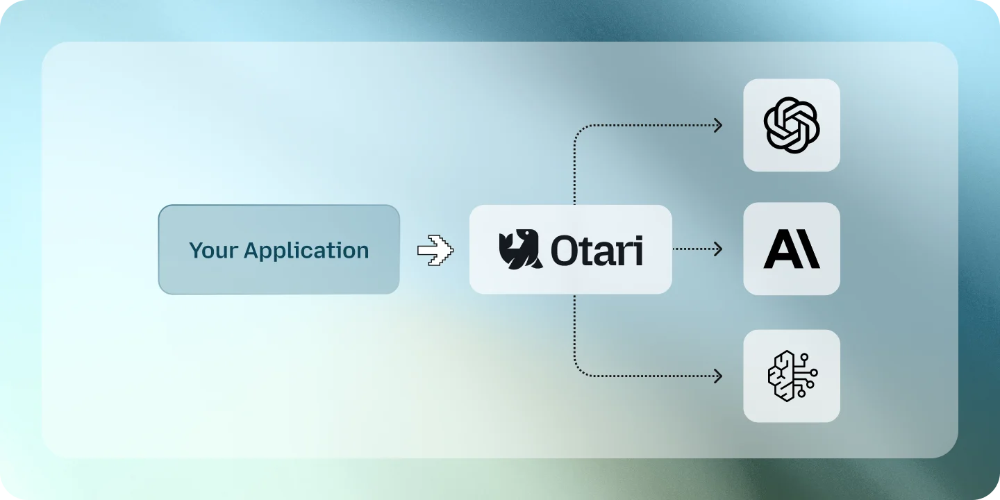
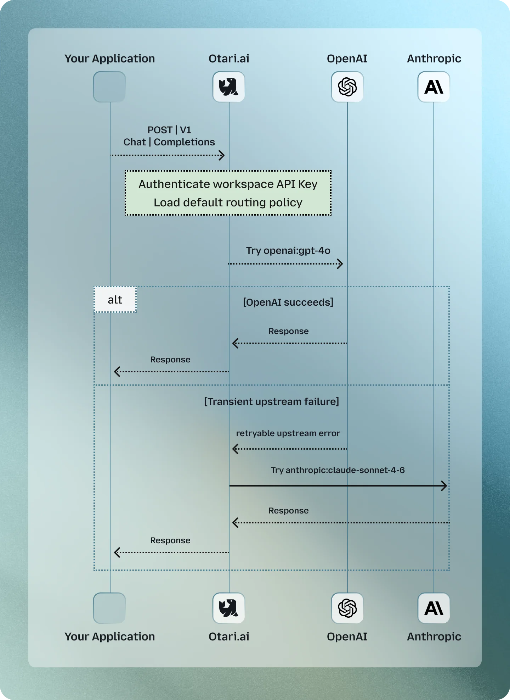

# Routing policies

A routing policy is a caller-facing model name that resolves to one or more real
models. Use a policy for failover, conditional selection, traffic splitting,
spill-over past a rate limit, or guardrails the caller cannot remove. Use an
[alias](models.md#model-aliases) when one name always maps to one target.



For provider selection within one model, an unpinned catalog ID already uses
[automatic routing](models.md#automatic-provider-selection), which keeps an
organization's own provider key first and otherwise considers estimated cost, load,
region and latency, with sticky sessions for conversation continuity.

## Failover

```yaml
routing:
  policies:
    fast:
      select:
        - default: openai:gpt-5-mini
      on_failure:
        - anthropic:claude-haiku-4-5
```

Callers send `model: fast`. If the first provider fails before any response is
sent, Otari tries the fallback. The response keeps the policy name; the Overview's Requests
and Usage tabs record the models that were attempted.



## Selection and failure are separate

`select` chooses where a request starts. `on_failure` lists what to try when a
candidate fails before its answer starts. The policy moves on to the next
candidate when:

- the provider returns any error: an outage, a rate limit, or a refusal as
  invalid (400);
- the provider has no credential configured. A provider nothing declares has
  none (keyless local backends included), and so does an entry that names no
  key, whatever the provider's own environment variable holds;
- the provider rejects the configured credential (401, or a 403 that does not
  reject the request itself);
- a Chat Completions candidate answers with no choices.

A candidate nothing declares that one of the deployment's hosted providers
serves is sent on the deployment's own credential, as a single model is
([hosted providers](hosted-providers.md#deployment-paid-credentials)). On
otari.ai, such an entry is billed to the organization's balance at the same rate
as a direct request, and is skipped when the balance cannot cover it.

When no candidate is left:

| Situation | Response |
| --- | --- |
| No candidate has a credential | `424 provider_not_configured` |
| Every candidate lacks a credential or had it rejected, and at least one was rejected | `424 provider_credential_rejected` |

Other all-candidates-failed outcomes are listed under
[Failure behavior](#failure-behavior).

```yaml
routing:
  policies:
    thrifty:
      select:
        - when:
            budget_used_pct: {gte: 80}
          target: openai:gpt-5-nano
        - default: openai:gpt-5-mini
      on_failure:
        - anthropic:claude-haiku-4-5
```

Selection entries are evaluated in order. The default must be last. Supported
conditions are:

- `budget_used_pct`
- `budget_remaining_usd`
- `user_id`
- `key_id`

All conditions in one `when` block must match. Numeric comparisons use exactly
one of `gt`, `gte`, `lt`, or `lte`. A budget condition reads the tightest
budget gating the request: the user's own budget, or a spend ceiling on the
calling API key, its workspace, its member or its organization that caps every
provider. A ceiling narrowed to one provider is not read, because which provider
serves the request is what the policy decides. A $0 budget reads as fully used.
A budget condition does not match a caller with no finite budget, a key excluded
from budget enforcement, or any request while `budget_strategy` is `disabled`.

A budget condition picks the target for a request the budget admits; it cannot
admit one the budget refuses. A request whose estimated hold is larger than what
remains is refused with `403 budget_exceeded` before the policy runs, even at a
low `budget_used_pct`. For a tier-down rule to act, size the budget well above
one request's hold, or send a lower `max_tokens`. See
[Holds and settlement](budget-enforcement.md#holds-and-settlement).

In a policy that can fall over, each candidate gets one upstream call unless a
retry count is configured, so a throttled provider hands over to the next
candidate at once rather than after its SDK's own retries. See
[Provider retries](configuration.md#provider-retries).

## Load balance across providers (weighted routing)

The weighted router chooses independently for each request and normalizes the
configured weights:

```yaml
routing:
  policies:
    balanced:
      select:
        - router: weighted
          candidates:
            - openai:gpt-5
            - anthropic:claude-sonnet-4-6
          weights:
            openai:gpt-5: 7
            anthropic:claude-sonnet-4-6: 3
        - default: openai:gpt-5
      on_failure:
        - gemini:gemini-2.5-flash
```

`7:3` and `70:30` describe the same split. A candidate omitted from
`weights` receives no initial traffic but remains available in the failure
ordering. At least one weight must be positive.

Each request is a fresh draw. Weighted routing has no conversation stickiness or
health-adjusted weights. If the selected provider fails before responding, Otari
continues through the remaining weighted pool, then `on_failure`.

Caller allow-lists filter candidates before weights are normalized. Use
`otari routing explain` to see the effective split for a restricted caller.

## Spill over when a model is full (priority routing)

The priority router keeps its candidates in the order written. Each request goes
to the first one that has room under its
[`per: model` rate limits](configuration.md#rate-limit-rules):

```yaml
rate_limits:
  - name: flash-cap
    per: model
    models: ["vertex:gemini-2.5-flash"]
    rpm: 100

routing:
  policies:
    summarize:
      select:
        - router: priority
          candidates:
            - vertex:gemini-2.5-flash   # takes every request up to 100 a minute
            - together:llama-3.3-70b    # takes the rest
        - default: together:llama-3.3-70b
      on_failure:
        - mistral:mistral-small
```

- A full candidate is skipped without being called. The Overview's Requests tab
  shows it in the request's routing plan as skipped, naming the limit that was
  full, and Prometheus counts it in `gateway_rate_limit_model_full{rule, model}`.
- The limit lives on the model, not on the policy, so the model is skipped the
  same way in `on_failure`, in a weighted pool, and in any other policy that
  names it. With Redis as `rate_limit_store`, the count holds across replicas.
- A candidate with room that fails before responding falls through to the next
  one, as in any policy: `candidates` handles "full", `on_failure` handles
  "broke".
- The per-model limits refuse with `429` only when every candidate is full,
  naming the limit that frees up soonest (and its `Retry-After`) but not the
  model.
- A per-key, per-user or deployment rule is checked before routing, so it can
  still refuse a request while every candidate has room.
- `Otari-Router: off` skips the order and starts from the default.

## Per-request control

Send `Otari-Router: off` to skip weighted or priority selection for one request
and use the policy default. There is no header that forces a router on: the
policy decides that.

## Mandatory guardrails

A policy can run guardrails even when the caller did not request them:

```yaml
routing:
  policies:
    safe:
      select:
        - default: openai:gpt-5-mini
      guardrails:
        - profile: prompt-injection
          mode: block
          on_unavailable: block
```

`mode` is required: `monitor` or `block`. `on` says what the guardrail
reads, and defaults to `[input]`; see
[What a guardrail reads](guardrails-reference.md#what-a-guardrail-reads).
`on_unavailable: block` fails closed when the guardrail service cannot run or
gives no verdict; `monitor` lets the request continue and records the skipped
check.

Organization-mandated and request-provided guardrails compose with policy
guardrails. See [How the layers compose](guardrails-reference.md#how-the-layers-compose).

## Explain a policy

Inspect a policy without calling a provider:

```bash
otari routing explain fast
otari routing explain thrifty --budget-used-pct 85
otari routing explain balanced --allowed-model "anthropic:*"
```

The command shows ordered candidates, filtered candidates and their reasons,
effective weighted shares, and mandatory guardrails. It reads `config.yml`
only, so it does not see policies created in the dashboard or through the API.

For those, open the policy in the dashboard: its **Test** section shows the
same plan, and for a policy with a budget tier-down, a budget-used field to
try it with. On a deployment you run, the API equivalent is
`POST /api/v1/routing/policies/explain`, which needs the operator; it can also
validate an unsaved draft. Members of an organization use
`POST /api/v1/organizations/me/routing-policies/explain` instead, from a
dashboard session, naming one of their workspaces in `workspace_id`. There, a
model the organization cannot reach is listed as left out, whether it comes from
a draft or a saved policy.

## Agent model recommendations

A policy decides the model of a request that reaches Otari. A coding agent that
talks to its provider directly can still ask Otari which model a new subagent
should run on, through `POST /api/v1/routing/recommend`, at the moment it spawns
the subagent, before the subagent has a prompt cache to lose.

Otari asks the decision model of the [subagent router](#subagent-routers) that
is switched on which candidate is the cheapest that would complete the task well
on the first attempt, given the harness, the subagent type, the parent's model,
the task description and the task. The candidate it picks is the
recommendation. The model the caller asked for is left out of the question, and
only the task's first 32,000 characters are sent. The call is charged at the
router's own rates.

The harness that asks picks the candidates: Claude Code chooses among
`agent_recommender_candidates`, its own `haiku`, `sonnet` and `opus` aliases by
default, and pi, through [pi-otari](https://github.com/mozilla-ai/pi-otari),
among the Otari model ids it sends with the request. Either way the
recommendation is billed to the caller, and nothing else is dispatched: the
harness runs the subagent with its own provider credentials.

The fields and errors are in the
[API reference](api-reference.md#routing-recommendations), and the Claude Code
plugin that asks is in the
[Claude Code guide](claude-code.md#let-otari-choose-a-subagents-model).

### Subagent routers

Which decision model answers is set on the **Subagent router** page of the
deployment view (`/api/v1/routing/recommenders`, operator-only), and nowhere
else: `config.yml` has no setting for it. A router is a
decision provider (TypeSafe, OpenRouter or a llama.cpp server), a model, an
optional API base, a key stored encrypted under `OTARI_SECRET_KEY`, and the
price per million input and output tokens the caller is charged. Several may
be stored and one is switched on at a time: the first one added is on, and
switching a later one on switches the rest off.

Billing and limits:

- Before the call Otari holds the most one recommendation can cost (65,536
  input and 1,024 output tokens at the router's rates). After it, Otari charges
  the tokens the decision model reported, or the hold when it reported none.
- The usage row names `otari:subagent-router`, never the router's own provider
  or model, and that label is what an API key's allow-list has to admit.
- A router that does not answer within 2.5 seconds fails the call, uncharged.
- To add a margin, put it in the rates; for free recommendations (from a local
  model, for example), set both rates to 0.

With no router stored, or every one switched off, nothing answers and the
route refuses with 400. A write reaches its own gateway worker at once and
every other worker or replica within 30 seconds.

## Managing policies at runtime

Config-file policies apply to every workspace. Operators can also
manage stored policies through the Routing page or `/api/v1/routing/policies`.
Stored policies belong to one workspace and can optionally be scoped to one
user. The operator's list, like `/api/v1/aliases`, shows the stored entries of
the workspaces in the operator's active organization, and the master key acts in
the default organization.

An organization's owners and admins manage their own workspaces' policies and
aliases through `/api/v1/organizations/me/routing-policies` and
`/api/v1/organizations/me/aliases`, which the Routing page uses for a caller who
does not operate the deployment. Those routes require the workspace named, must
name a workspace of the caller's own organization, accept no user scope, and
refuse a target the organization holds no provider access for. Both reads take a
server-capped `limit`, which bounds the response rather than paginating it. A
member of the organization reads the same two lists and writes neither.

Those routes read and write workspace-wide entries only. A user-scoped entry
(`user_id` names an API-key user, not a dashboard identity) is managed only on
the deployment-wide routes.

The authenticating API key determines which workspace resolves a policy.
User-scoped entries take precedence over wider entries. A config-file policy
cannot be changed through the API.

Changes apply immediately on the worker that accepts the write. Other workers
refresh stored routing configuration within 30 seconds.

Use the generated OpenAPI document for create, rename, delete, list, and explain
request schemas.

## Rules and limits

- A plan may contain at most five candidates, including router pools and
  `on_failure`.
- Targets must be concrete provider or instance selectors. Policies and aliases
  cannot chain.
- Policy names cannot contain `:` or `/` or collide with an alias or provider
  instance.
- `routing.enabled: false` disables policy resolution but still validates the
  configured policies.
- Caller model allow-lists apply to every candidate.
- Dynamic policies apply to Chat Completions, Messages, and Responses. A static
  one-target policy can resolve on other model-taking endpoints.

## What is billed and what the caller sees

Pricing, budgets, and usage use the resolved model. Completion responses use the
policy name.

Each failed attempt before a successful fallback gets an `absorbed` usage row.
All attempts share a `request_group_id`, which is the request's `Otari-Request-ID`.
Absorbed rows have no settled model cost and do not increase request or error
totals; the final row represents the caller-visible request.

Every successful Chat Completions, Messages, and Responses response, routed or
not, carries these headers:

| Header | Value |
| --- | --- |
| `Otari-Provider` | The provider instance that served the request, by its configured name (`openai`, `azure-eu`). Never its base URL or credentials. |
| `Otari-Model` | The model the serving provider was sent, as that provider names it (`gpt-5-mini`, `claude-haiku-4-5`), without the instance prefix. A routing policy, an alias, or a catalog ID keeps its own name in the body's `model`, so this is where a caller sees which model answered. A request naming a model reports that model. Left out when the name is not printable ASCII. |
| `Otari-Attempt-Count` | How many candidates the request was sent to, including the one that served. A candidate skipped without being called, such as a model a rate limit had no room on, is not counted. |
| `Otari-Fallback` | `true` when a candidate other than the plan's first served the request, whether the first failed or was skipped; otherwise `false`. |
| `Otari-Response-Duration-Ms` | Whole milliseconds from the start of the handler preamble to the provider answering the request, failed candidates included. For a streamed response, to the stream opening or its first chunk, since the headers go out then. |
| `Server-Timing` | The same duration split into Otari's time and the provider's, in [W3C Server Timing](https://www.w3.org/TR/server-timing/) form: `otari;dur=4.2;desc="Otari before the provider", upstream;dur=812.5;desc="Provider until its answer or first chunk", total;dur=816.7;desc="Otari and the provider"`. `otari` runs until the first candidate is sent: the budget hold, routing, rate limits and preparing the call. `upstream` runs from there to the answer, failed candidates included, or for a stream to its first chunk, or to the end of the first-chunk hold when the provider is slower. Gateway tools that run between provider calls, such as web search or code execution, count toward `upstream`. Durations are milliseconds to a tenth. |

A request naming a model or an alias reports `1` and `false`. Streaming responses
carry the same values: failover happens before the stream opens, so the serving
candidate and the attempt count are already known when the headers are sent. A
failure later in the stream is reported in the stream and changes neither. The
request's cost is `usage.cost_usd` in the body, and the part of it that is
tool charges `usage.tool_cost_usd`, as described in the
[API reference](api-reference.md#request-id-and-inline-cost).

Built-in tool charges settle on the final row. Before each attempt, Otari checks
the candidate's price and the remaining budget, including a budget narrowed to
that candidate's provider:

- A fallback whose provider-narrowed budget has no room is skipped, and the
  next candidate is tried.
- A budget on every provider that cannot cover a pricier fallback stops the
  chain.
- What a fallback spends counts against its own provider's budgets.

In a plan with more than one candidate, a chat completion's `reasoning_effort`
is left off each candidate that [models.dev](https://models.dev) says does not
reason. A candidate models.dev does not describe gets it as asked.
`response_format` is never left off; check each candidate's
`supported_parameters` on `GET /api/v1/models` when building a policy that
sends it.

## Failure behavior

Failover occurs only before response bytes reach the client. A streamed
candidate that fails before its first chunk falls over like one that fails to
open, as long as the failure comes within `streaming_first_chunk_hold_ms`
(15 seconds by default; `0` limits failover to candidates that fail to open). A
streaming failure after the stream begins is returned to the client because
switching models mid-answer would corrupt the response.

A tool loop that has already produced assistant state cannot be replayed on
another provider. On Chat Completions, a stream that has reported one of Otari's
web searches or fetches in `otari_tool_calls` has sent response bytes, so it is
committed from that report on. Shared service failures, such as an unavailable mandatory
guardrail or sandbox, also do not improve by changing candidates.

If every candidate of a plan with more than one candidate fails, Otari returns a
gateway error in its own words, never a provider's message. A plan with one
candidate answers as naming that model directly would.

| Every candidate... | Response |
| --- | --- |
| rejected the request as invalid (400) | `400 all_candidates_rejected` |
| found the prompt too long | `context_length_exceeded` |
| refused image content the request carries, in wording Otari recognizes | `unsupported_content` |
| failed to produce output matching the requested JSON schema (Groq's `json_validate_failed`) | `structured_output_failed`. Sending the request again may succeed. |
| refused the request as too large (413) | `413 request_too_large`. Shrink the request; sending it again unchanged does not help. |
| refused a parameter the request carries (such as `response_format` on a model with no JSON mode), as named by Otari's provider library | `unsupported_parameter`, with `detail` naming the parameters. A parameter a provider refuses with its own 400 counts as an ordinary rejection. |
| did not know the model (404) | `502` |
| was removed by caller restrictions | `403`, without revealing the hidden targets |

## In the dashboard

The Routing page manages stored policies.

- **Create policy** offers one kind at a time (Fallback, Split traffic, Spill
  over at rate limits, Tier down on budget), each with only its own fields.
- **Fallback** ([Failover](#failover)): name the policy, pick the main model,
  and list at least one backup under "If unavailable, use", each a model other
  than the main one and the other backups. The backups are `on_failure`, in the
  order shown.
- **Spill over at rate limits**
  ([priority routing](#spill-over-when-a-model-is-full-priority-routing)): order
  the models with the arrows, and add the limit under Settings, Rate limit
  rules, counted for "Each model". On an existing policy, pick "Spill over" in
  its Main selection section.
- **Combining kinds**: open the policy from the list once it exists. Its page
  has a section each for the main selection, the fallback chain, a budget
  tier-down and guardrails, and each section saves on its own, writing the rest
  of the policy back unchanged.
- A policy from `config.yml`, or one using options the page cannot show, opens
  read-only with its spec in full.
