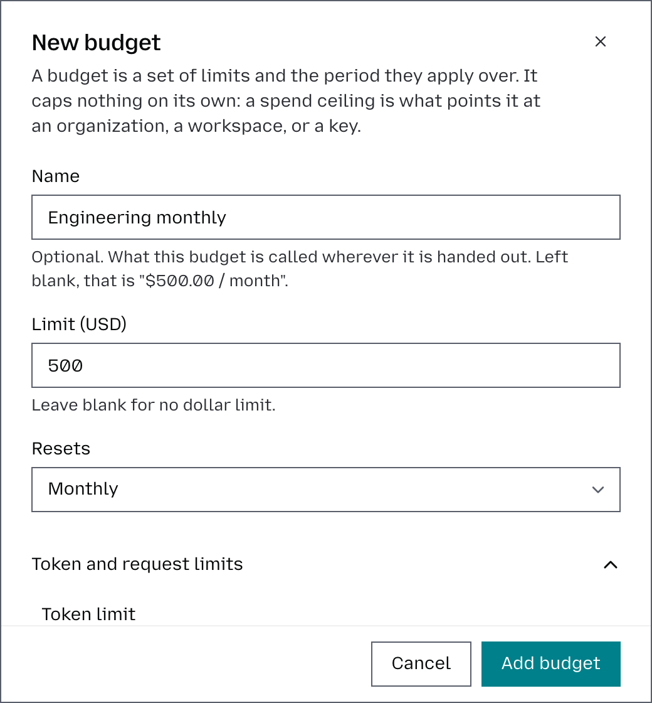
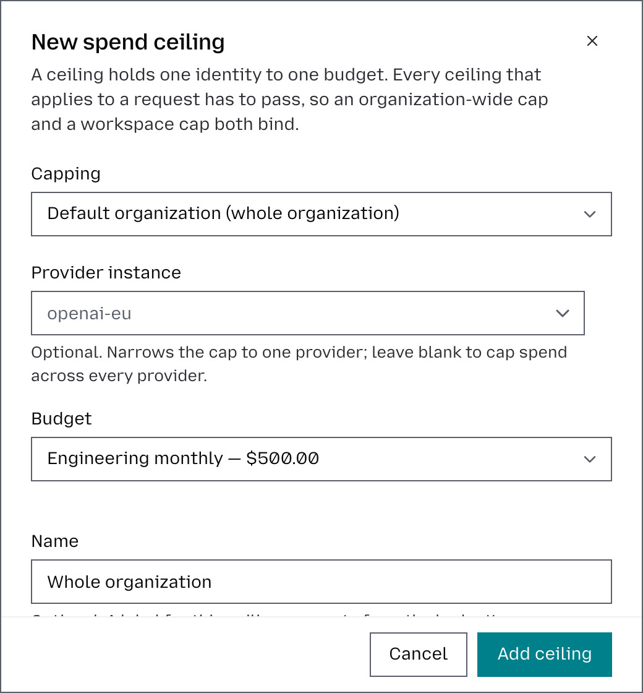
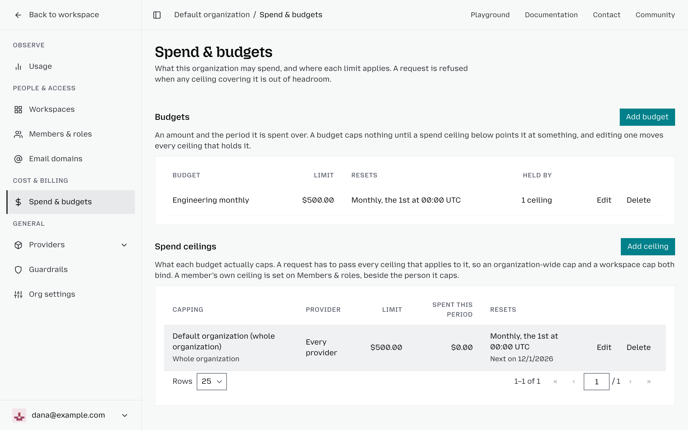

# Set a budget and ceiling

A budget defines how much can be spent and over what period of time. On its own, it doesn’t limit spending. To enforce a budget, you need to create a **spend ceiling** and apply it to an organization or workspace.

A budget does not block requests until you attach it to a spend ceiling.

For the model behind scopes and periods, see [Budgets](budgets.md).

## Create a budget

1. From the dashboard, open **Organization** and select **Spend & budgets**.
2. Click **Add budget**.
3. Fill in the dialog:
   1. **Name**: Give it a name (optional)
   2. **Limit (USD)**: USD limit, or leave blank for no limit
   3. **Resets**: Daily, Weekly, or Monthly
   4. **Token and request limits**: Optionally, also cap tokens or requests per period
4. Click **Add budget**.

The budget resets automatically at the start of each period, in UTC.

## Apply a spend ceiling

A spend ceiling links a specific identity to a budget, defining what each budget actually limits. Every ceiling that applies to a request must be respected. For example, if both an organization-wide ceiling and a workspace ceiling apply, the request must stay within both limits. To create a ceiling:

1. In **Spend & budgets**, click **Add ceiling**.
2. Fill in the dialog:
   1. **Capping**: Choose whether the ceiling applies to the entire organization or to a specific workspace.
   2. **Provider instance**: Select a specific provider to limit spending for that provider only, or leave this blank to apply the ceiling across all providers.
   3. **Budget**: Select the budget you want this ceiling to use.
   4. **Name**: Optionally, give the ceiling a name to make it easier to identify.
3. Click **Add ceiling** to save it.

Requests matching the ceiling count toward its budget. When the budget is exhausted, Otari blocks new matching requests until the next reset.

Multiple ceilings are enforced independently. A request is blocked when any matching ceiling is exhausted.

To cap a single API key, set a budget on the key itself; see [Cap a key's spend](api-keys.md#cap-a-keys-spend).

## Confirm enforcement

Check the budget's status in **Spend & budgets**. Each budget shows its spend against its limit as a bar. Past 80% use, the part over 80% turns red. Once the budget is exhausted, the whole bar and the amount turn red.

