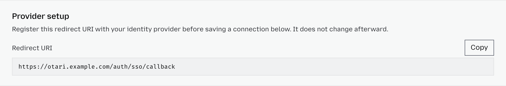
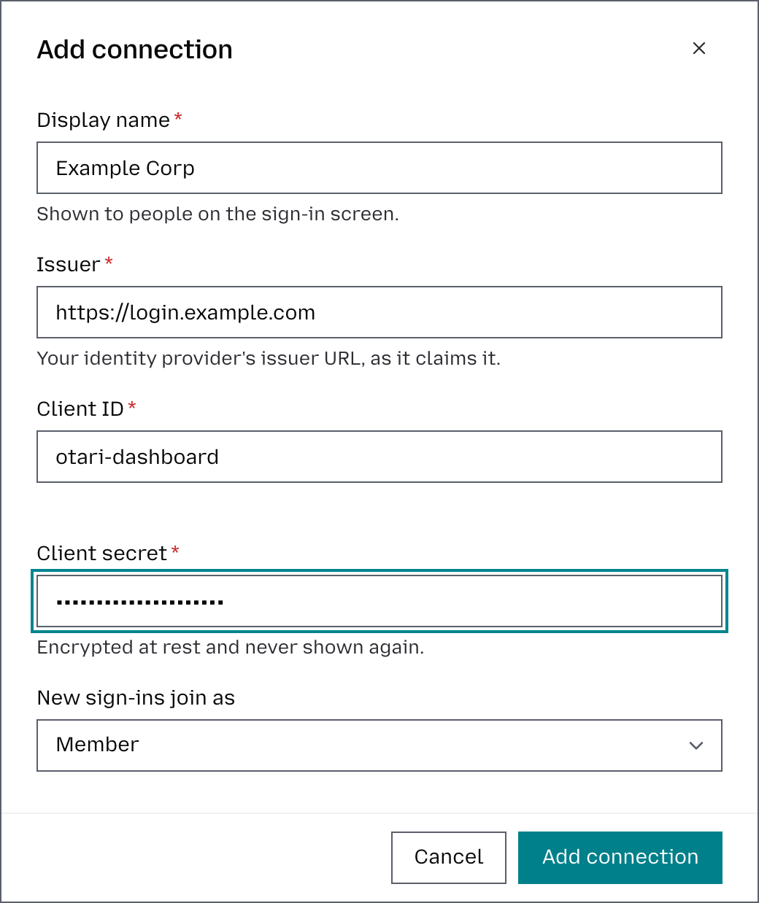
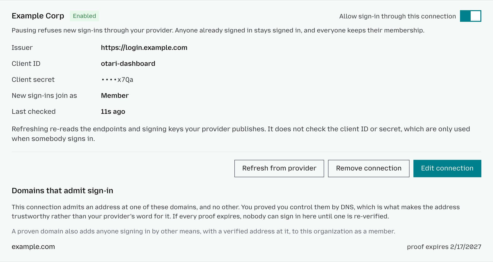
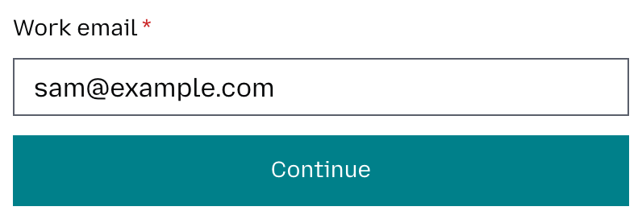
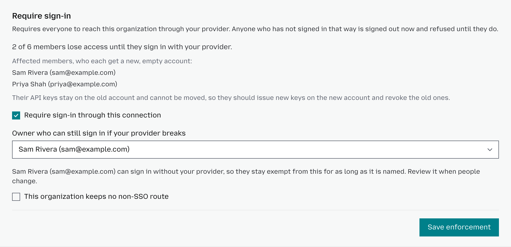

# Set up single sign-on

An organization **Owner or Admin** can let colleagues sign in to Otari through the company's own identity provider, such as Okta, Auth0, Microsoft Entra ID or Google Workspace. Any provider that speaks OpenID Connect (OIDC) works. SAML is not supported.

Everything here is done from the organization's own settings. Once the deployment offers single sign-on, you do not need whoever runs it.

## Before you start

You need two things from your own company:

- Someone who can register an application (an OIDC client) in your identity provider.
- Someone who can add a DNS record for your email domain.

You also need a deployment that offers single sign-on. It does by default. If **Single sign-on** is missing from **Organization**, whoever runs the deployment has turned it off, and only they can turn it back on.

## Register Otari with your identity provider

1. Go to **Organization** → **Single sign-on**.
2. Copy the **Redirect URI** under **Provider setup**.
3. In your identity provider, create an OIDC web application with that redirect URI. Allow the `openid`, `email` and `profile` scopes.
4. Keep the application's issuer URL, client ID and client secret for the next section.

## Add the connection

1. On **Single sign-on**, click **Add connection**.
2. Fill in the form:
   - **Display name**: what people see on the sign-in screen, for example your company's name.
   - **Issuer**: your identity provider's issuer URL.
   - **Client ID** and **Client secret**: the ones from the application you registered.
   - **New sign-ins join as**: Member or Viewer.
3. Click **Add connection**.

## Prove your email domain

A connection only admits addresses at a domain your organization has proven it controls.

1. Go to **Organization** → **Email domains** and claim your domain, as in [Let colleagues join by email domain](members.md#let-colleagues-join-by-email-domain).
2. Back on **Single sign-on**, check that the domain is listed under **Domains that admit sign-in** with a proof date.

A proof expires, and the page shows when. Verifying again before that date does not extend it. Once it expires, sign-in through the connection stops until you verify the domain again on **Email domains**.

## Sign in

1. On the sign-in screen, click **Sign in with your company (SSO)**.
2. Enter your **Work email** and click **Continue**. Otari sends you to your identity provider and back.

Try it yourself before telling colleagues.

A person's first sign-in through the connection creates a new account, even if they already had one with the same address. API keys stay on the old account, so they create new keys on the new one. See [Accounts](sso.md#accounts).

## Require single sign-on

This step is optional. Once at least one person has signed in through the connection, you can make it the only way into the organization.

1. On **Single sign-on**, under **Require sign-in**, read who would lose access until they sign in through your provider.
2. Select **Require sign-in through this connection**.
3. Choose the **Owner who can still sign in if your provider breaks**.
4. Click **Save enforcement**.

See [Requiring sign-in](sso.md#requiring-sign-in) for what this refuses.

## Pause or remove the connection

On **Single sign-on**, turn off **Allow sign-in through this connection** to pause it, or click **Remove connection**. People who already joined keep their membership either way.

For how connections, accounts and enforcement work, see [Single sign-on](sso.md).
