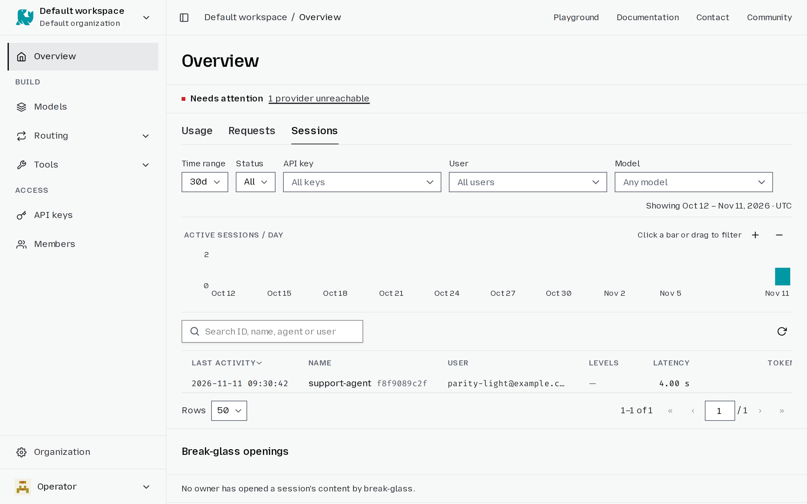
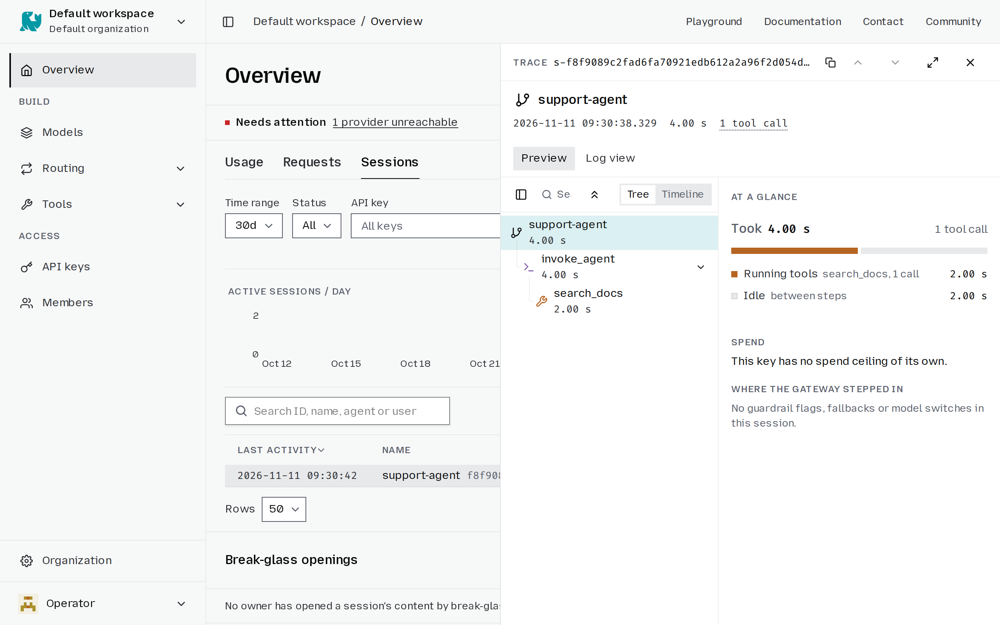

# Sessions

A session is one run of an agent: its turns, the model requests and the tools it
ran, with how long each took and what it cost. Otari records one for the requests
it serves, so you can see what an agent did, not only what one call did.

## Look at a session

1. Open **Overview** and pick the **Sessions** tab.

   

2. Click a session to open it.

   

The tab shares the Overview's time range and its user, API key, model and status
filters. A session opens on **At a glance**, which splits its time and cost, and
shows what filled the model's context window. Pick a span to see its details, or
switch to the timeline or the flat log. From the **Requests** tab, **View trace**
on a request opens its session on that call.

## Collect sessions

Otari records sessions for the completions it serves, which is on by default. On
a deployment you run, [Store agent traces](https://docs.otari.ai/self-hosting/operations/trace-storage) says how to turn it
off or change how long sessions are kept.

- **Claude Code and Codex** are recognized automatically when they route through
  Otari. Claude Code can also send its sessions without routing its model
  traffic; see [Send Claude Code sessions to Otari](use-with-claude-code.md#send-claude-code-sessions-to-otari).
- **Your own agent** sends the same `Otari-Conversation-Id` header on every
  request of one run, tool-result follow-ups included. Give each run, and each
  subagent, its own id. A request without the header is a session of its own.

  ```bash
  curl https://api.otari.ai/api/v1/chat/completions \
    -H "Authorization: Bearer $OTARI_API_KEY" \
    -H "Otari-Conversation-Id: support-chat-1042" \
    -H "User-Agent: support-agent/1.0" \
    -H "Content-Type: application/json" \
    -d '{"model": "anthropic:claude-sonnet-4-6", "messages": [{"role": "user", "content": "Where is my order?"}]}'
  ```

  The first product token of `User-Agent` names the agent in the list.
- **An agent instrumented with OpenTelemetry** exports its spans to Otari; see
  [Import usage from outside Otari](external-usage.md#opentelemetry).

Every signal that groups requests into a session is in
[What makes a session](https://docs.otari.ai/reference/gateway/sessions-reference#what-makes-a-session).

## Keep what a session was about

By default a session keeps no prompt, command or file path. A workspace owner or
admin, or an organization owner or admin, can turn that on where the deployment
allows it:

1. Open **Workspaces** and click the workspace.
2. On its **General** tab, turn on **Keep what agent sessions were about**.

Where the deployment also keeps tool output, a second switch, **Keep what tools
returned**, is shown, on by default. The client has to send content too: a routed
request sends the header `Otari-Trace-Content: keep`, and Claude Code sends it
with `OTEL_LOG_USER_PROMPTS=1` and `OTEL_LOG_TOOL_DETAILS=1`. Content is stored
encrypted.

What is kept is private to the session's user. They can share a session with
their organization's admins from the session itself; who else can read it, and
when, is in [Who reads content](https://docs.otari.ai/reference/gateway/sessions-reference#who-reads-content).
