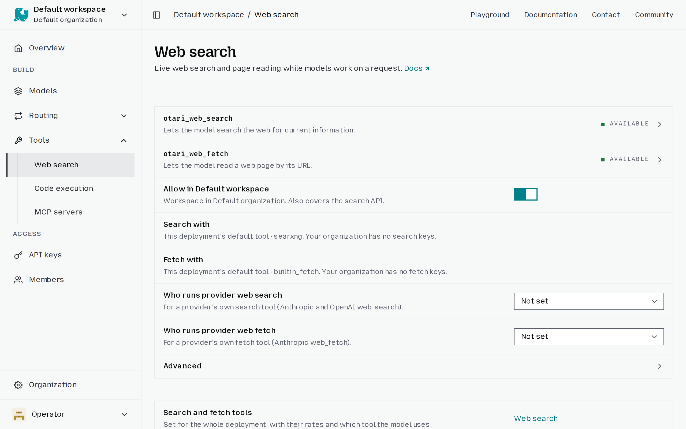

# Web search

The **Web search** settings let you control how requests from a workspace can access and search the web. You can customize web access for individual workspaces, including which keys searches use, which domains can be accessed, and how many results a search can return.

To configure web search for a workspace:

1. Select the workspace in the top-left corner.
2. Go to **Tools** → **Web search**.
3. Turn **Allow in <workspace>** on to allow web search for requests in this workspace, or off to block the web search and fetch tools Otari runs.
4. Under **Search with** and **Fetch with**, choose which of the organization's keys the workspace uses, or a default. Only an owner or admin can change these.
5. Under **Who runs provider web search** and **Who runs provider web fetch**, choose whether a provider's own search and fetch tools run on the provider or on Otari, or leave them **Not set**.
6. Under **Advanced**, set **Max results for this workspace** to limit the number of results returned by each search.
7. Use **Allowed domains** to restrict searches and fetched content to specific websites.
8. Use **Blocked domains** to prevent searches and fetches from accessing specific websites.

The domain lists apply to the search and fetch Otari runs, not to direct searches or to a provider's own tools running on the provider; see [Per-workspace web-access policy](https://docs.otari.ai/reference/gateway/tools#per-workspace-web-access-policy).

## The organization's search and fetch keys

**Organization** → **Providers** → **Web search** lists the organization's
search keys and fetch keys, one table each. Only owners and admins manage them.

- **Add a key**: pick the provider, then enter a name and the API key. **More
  settings** holds a custom endpoint and the provider's options.
- **Star a key** to make it the default for every workspace that has not pinned
  another. Click a filled star to unset it. A key that is neither starred nor
  pinned is not used.
- **Archive a key** to take it out of use; restore or delete it later.

A workspace uses the key its owners or admins pinned, else the starred key, else
the deployment's own search or fetch tool. Editing a key never shows its secret,
and moving it to another endpoint asks for the API key again. A key the
deployment cannot decrypt is marked unreadable. Prices for search and fetch calls
are set by the deployment's operator, not here.
