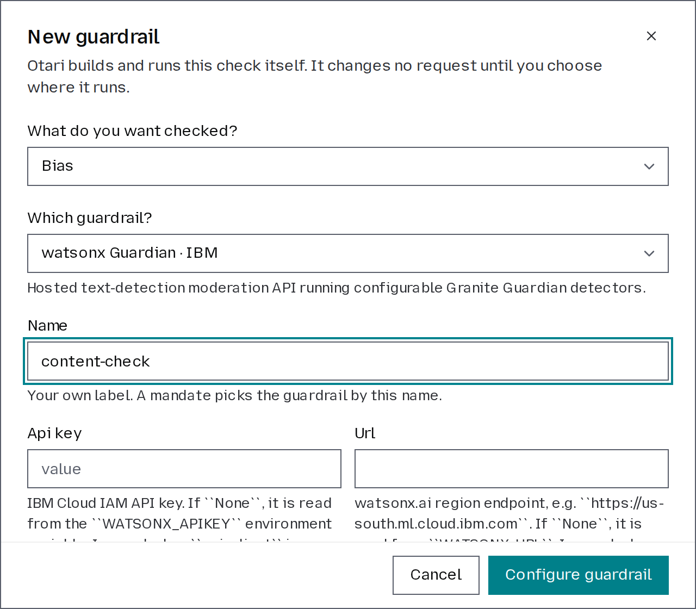
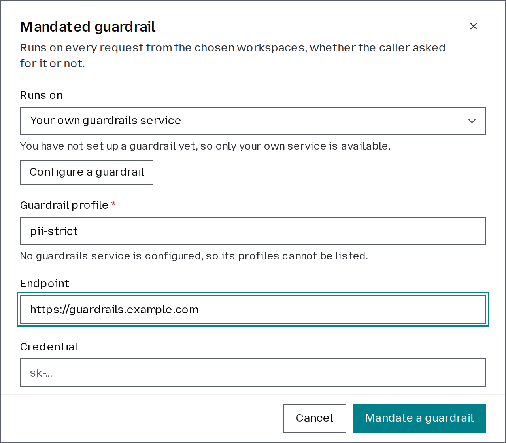

# Manage guardrails

Guardrails evaluate model traffic before it reaches a provider. Use them to detect content that violates your safety or compliance requirements.

A guardrail can monitor matching requests or block them, and can be applied to the entire organization or only to selected workspaces.

For what each guardrail checks, see [Inference Guardrails](https://docs.otari.ai/guides/guardrails/guardrails).

## Configure a guardrail

Only organization owners and admins can add, edit, or delete guardrails.

1. From the dashboard, open **Organization** → **Guardrails**.
2. Click **Configure guardrail**.
3. Follow the steps in the dialog:
   1. Select the type of risk you want to detect, such as content safety, PII, or hallucination.
   2. Choose a guardrail from the catalog for that check.
   3. Give the guardrail a name.
   4. Enter the provider's API key, if it needs one.
   5. Complete the remaining configuration steps. These may vary depending on the guardrail provider you selected.
4. Click **Configure guardrail** to save your settings.

## Mandate a guardrail

Each guardrail can be applied across the entire organization or to specific workspaces. You can configure it to either **block requests** or **monitor them** without blocking. Once mandated, the guardrail will run on every chat completions, messages and responses request from the selected workspaces. Embeddings and other endpoints are not checked.

1. In **Guardrails**, click **Mandate a guardrail**.
2. Choose whether you want to use a guardrail configured from the catalog or your own guardrail service.
3. Choose the **Mode**: whether the guardrail should block requests or monitor them only.
4. Choose what should happen **If unreachable**: refuse the request or serve it unchecked. Only blocking guardrails can refuse requests; monitoring guardrails will always serve them.
5. Select where the guardrail should run: every workspace, including new ones, or selected workspaces.
6. Click **Mandate a guardrail** to save your settings.

## Test a guardrail

Before applying a guardrail, you can test how it evaluates specific content. Enter the text you want to check, and the guardrail will process it just as it would a real request. Nothing entered during the test is saved. To test a guardrail:

1. In **Guardrails**, click Test on the guardrail you want to test. A guardrail from your own service is tested from its mandate's row, once mandated.
2. Enter the text you want to check against the guardrail.
3. Optionally, fill in any other fields the guardrail takes, such as a model output for checks that evaluate responses.
4. Click Run test to see how the guardrail evaluates the content.

## Edit or delete a guardrail

In **Guardrails**, click **Edit** on the guardrail you want to update to modify its credentials or configuration parameters.

To delete a guardrail, make sure it is no longer mandated. If the guardrail is still in use, click **Remove** on each of its mandates first. Once all mandates have been removed, click **Remove** on the guardrail itself.

Deleting a guardrail is permanent and cannot be undone. Make sure you no longer need the guardrail before confirming the deletion.
